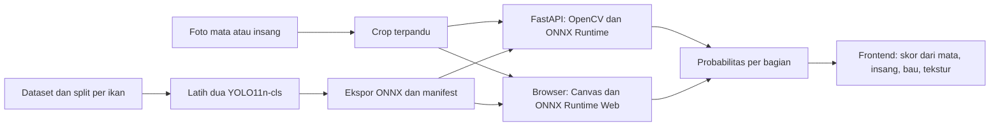

# Rencana AI kesegaran ikan Nelayanku

Dokumen implementasi untuk branch `feat/ai-services`. Acuan produk ada di [PRD §10](../docs/PRD.md#10-spesifikasi-ai) dan kontrak UI di `feat/frontend-ui` commit `836f54c`. Saat rencana disusun, entry point pelatihan serta folder dataset belum terisi. Frontend memiliki simulasi untuk foto contoh mata dan pilihan manual untuk foto baru serta insang.

Download dan unzip dilakukan manual. Seluruh data berada di `ai_services/data/`. Gunakan branch yang sudah tersedia; jangan membuat branch/worktree baru, commit, atau push tanpa instruksi eksplisit pengguna.

Pembaruan pembagian pekerjaan, 11 November 2026 WIB. Branch `feat/ai-services` mengerjakan tooling dataset, model, pipeline OpenCV, API dan kontrak integrasi. Pengguna mengunduh dataset secara manual ke `ai_services/data/raw/`. Langkah integrasi frontend/browser di dokumen ini merupakan pekerjaan pada branch frontend/integrasi terpisah. Draf awalnya tersimpan di `codex/frontend-ai-integration-draft`. Snapshot sebelum pemisahan ada di `codex/backup-ai-services-before-split`. Status dan bukti terkini mengikuti [instruksi.md](instruksi.md).

## 1. Arsitektur dan urutan kerja

**P0 — foto terpandu.** Latih dua model `YOLO11n-cls`, satu untuk mata dan satu untuk insang. Operator memilih spesies, memotret kedua bagian secara terpisah, lalu mengisi bau dan tekstur. Kamera atau editor unggah menentukan potongan area yang dikirim ke model. Ekspor model ke ONNX. FastAPI menjalankan ONNX Runtime dengan preprocessing OpenCV, sedangkan browser menjalankan artefak yang sama dengan ONNX Runtime Web (WASM) untuk kebutuhan dermaga tanpa sinyal.

**P2 — crop otomatis.** Tambahkan `YOLO11n` detection yang mencari kotak mata atau insang terlihat pada foto ikan. Hasil crop masuk ke classifier P0. Tahap ini bergantung pada data beranotasi kotak dan memakai foto terpandu sebagai fallback.



## 2. Dataset dan pelatihan YOLO

| Model | Kelas keluaran | Data awal |
| --- | --- | --- |
| Mata | `very_fresh`, `fresh`, `not_fresh` | FFE v1 untuk baseline tiga kelas. Gunakan foto HP lokal untuk mengukur kesenjangan kondisi dermaga. [FFE dan atribusi](https://data.mendeley.com/datasets/xzyx7pbr3w/1) |
| Insang | `fresh`, `not_fresh` | Audit versi HansLab untuk subset `gill-fresh` / `gill-non-fresh`. Ambil foto lokal dengan insang terbuka dan label acuan. [HansLab](https://universe.roboflow.com/hanslab/fish-freshness-classification) |

1. **Inventaris data.** Simpan versi sumber, lisensi, ID foto asli, `fish_id`, kelompok tangkap/sesi, spesies, bagian tubuh, label, dan metode penetapan label. Gunakan `ai_services/data/raw/` dan `ai_services/data/interim/` yang sudah diabaikan Git. Kelas FFE mengikuti hari penyimpanan pada dataset tersebut. Validasi label lokal dengan penilai perikanan memakai protokol penyimpanan dan penilaian yang dicatat. HansLab memakai dua label mata sehingga pemetaan otomatis ke tiga kelas mata tidak digunakan. Mulai pengumpulan lokal dari kembung, tongkol, dan cakalang sesuai pilihan frontend. Aktifkan model hanya untuk kombinasi spesies dan bagian yang punya hasil uji memadai.
2. **Bagi sebelum augmentasi.** Mulai dari 70/15/15 untuk train/val/test, dengan kelompok per individu dan sesi/lot bila pengambilan saling berkaitan. Mata dan insang dari ikan yang sama tetap berada pada split yang sama. Cari duplikat dan turunan augmentasi lintas sumber. Jika identitas ikan atau asal augmentasi tidak dapat dipastikan, pakai data itu untuk eksplorasi pelatihan dan keluarkan dari validasi serta uji rilis. Kunci satu set uji foto HP lokal yang terpisah, mencakup variasi perangkat, cahaya, sudut, serta ikan basah atau tertutup es.
3. **Latih baseline.** Isi `train.py` dengan entry point `--part eye|gill`, root dataset klasifikasi `train/<kelas>`, `val/<kelas>`, `test/<kelas>`, serta konfigurasi yang tercatat. Mulai transfer learning dari `yolo11n-cls.pt` dengan `imgsz=224`, maksimum 50 epoch dan early stopping. Tetapkan seed, pin dependensi, simpan konfigurasi dan `best.pt` berdasarkan validasi. Terapkan resize/crop terkontrol pada train, val, dan inferensi. Augmentasi ringan hanya di train, misalnya rotasi kecil dan variasi pencahayaan yang telah ditinjau. Pertahankan rona insang dan area mata pada crop. [Klasifikasi YOLO](https://docs.ultralytics.com/tasks/classify/) · [Model YOLO11](https://docs.ultralytics.com/models/yolo11/)
4. **Uji dan pilih ambang.** Laporkan macro-F1, precision/recall dan jumlah sampel per kelas/spesies, confusion matrix, serta proporsi foto yang dapat dinilai pada set uji lokal. Untuk probabilitas yang akan masuk ke skor, cek kalibrasi dan setel ambang abstain pada validasi, termasuk foto salah bagian dan foto tanpa objek. Ukur khusus kesalahan `not_fresh` → `fresh`/`very_fresh` dan trade-off ambang terhadap cakupan. Sepakati batas kesalahan dan minimum sampel bersama tim produk/perikanan sebelum membuka test. Jika gate gagal, kombinasi spesies/bagian tetap manual. Simpan hasil, keterbatasan, dan atribusi dalam model card per rilis.
5. **Ekspor dan versi.** Ekspor baseline FP32 ke ONNX dengan bentuk statis `1×3×224×224`. Manifest rilis mengikat checksum SHA-256, versi bundle, model per bagian, urutan kelas hasil ekspor, spesies yang aktif, nama/bentuk tensor, preprocessing, tipe keluaran (`logits` atau `probabilities`) dan aturan abstain. Terapkan softmax satu kali hanya bila artefak menghasilkan logits. Uji PyTorch ↔ ONNX CPU ↔ browser WASM pada fixture yang sama. Kuantisasi dipilih setelah mengukur dampaknya pada ukuran, kecepatan, kesalahan per kelas, dan kompatibilitas WASM. Periksa kewajiban lisensi Ultralytics dan bobot sebelum distribusi. [Ekspor Ultralytics](https://docs.ultralytics.com/modes/export/) · [Lisensi Ultralytics](https://www.ultralytics.com/license)

## 3. Alur gambar dengan OpenCV

| Langkah | Perilaku yang direncanakan |
| --- | --- |
| Potong di klien | P0 menerima satu crop persegi dari bingkai kamera atau editor unggah. Petakan koordinat overlay ke piksel foto setelah koreksi orientasi, termasuk offset `object-fit: cover`, lalu sertakan margin agar tepi area tetap terlihat. Kompres JPEG/PNG dengan sisi terpanjang maksimal 1.280 px. Buffer `160×160` yang ada di frontend dipakai untuk cek kualitas, sehingga alur model perlu crop resolusi asli tersendiri. |
| Validasi dan decode | Terima JPEG/PNG sesuai signature berkas. Batasi request di proxy dan aplikasi, baca dengan batas byte, lalu validasi dimensi dari header sebelum alokasi gambar. Decode ke BGR dengan `cv2.imdecode`, terapkan orientasi EXIF tepat sekali untuk foto mentah, dan tolak gambar rusak atau bentuk crop yang tidak sesuai. Browser mengekspor crop yang sudah terorientasi. [OpenCV imgcodecs](https://docs.opencv.org/4.x/d4/da8/group__imgcodecs.html) |
| Periksa kualitas | Hitung rerata luminans, rasio piksel silau, dan varians `cv2.Laplacian` pada ROI grayscale `160×160`. Gunakan ukuran, koefisien, kernel dan kebijakan tepi yang sama pada fixture browser/server sebelum menyamakan ambangnya. Kalibrasikan ambang gelap, silau, buram dan ukuran minimum crop pada foto lokal. Bila gate gagal, kembalikan alasan untuk foto ulang atau penilaian manual. [Operator Laplacian OpenCV](https://docs.opencv.org/4.x/d5/db5/tutorial_laplace_operator.html) |
| Buat tensor model | Ubah BGR → RGB, resize crop persegi ke `224×224` dengan interpolasi yang dicatat, ubah ke `float32`, skala `[0,1]`, susun CHW, lalu tambahkan batch. Cocokkan transform val/train dengan manifest dan uji tensor terhadap fixture RGB, termasuk crop tidak simetris dan foto berorientasi EXIF. Pertahankan warna asli untuk klasifikasi insang. |
| Inferensi dan hasil | Pilih sesi ONNX sesuai `part`, baca output dengan urutan label manifest, validasi probabilitas finite dalam `[0,1]` dengan jumlah ≈1, lalu jalankan aturan abstain. Jika foto dan prediksi lolos, kirim semua probabilitas, termasuk versi model. Skor kesegaran akhir dihitung frontend setelah input bau dan tekstur. |

**Crop otomatis P2.** Anotasi bounding box `eye` dan `gill` pada foto lokal dan gunakan split per ikan yang sama. Latih `yolo11n.pt`, cek recall lokasi dan IoU/mAP per bagian, lalu ukur skor klasifikasi ujung ke ujung dari crop hasil deteksi. Di jalur foto utuh, petakan koordinat hasil deteksi dari letterbox ke piksel foto asli, tambahkan margin, potong ke batas gambar, dan bentuk crop persegi sebelum quality gate. Jika bagian tertutup, tidak ditemukan, terlalu kecil, atau beberapa ikan membuat target ambigu, arahkan ke crop terpandu. Endpoint foto utuh ditambahkan saat P2, dengan kontrak inferensi yang sama per bagian. [Referensi pipeline dua tahap](https://journals.plos.org/plosone/article?id=10.1371/journal.pone.0284804)

## 4. Kontrak FastAPI v1

`POST /v1/freshness/predict` menilai **satu bagian per request**. Body `multipart/form-data` berisi `image` (crop JPEG/PNG, batas awal 5 MiB), `part` (`eye` atau `gill`), dan `species` (`kembung`, `tongkol`, atau `cakalang`). Uji orientasi dan batas dimensi sebelum decode penuh. Gunakan FastAPI `UploadFile`, skema Pydantic, dan dokumentasi OpenAPI. [Upload berkas FastAPI](https://fastapi.tiangolo.com/tutorial/request-files/)

Contoh respons HTTP 200 untuk mata. Nilainya ilustratif.

```json
{
  "requestId": "req-123",
  "status": "ok",
  "part": "eye",
  "species": "kembung",
  "modelVersion": "freshness-0.1.0",
  "probabilities": { "veryFresh": 0.81, "fresh": 0.16, "notFresh": 0.03 }
}
```

Untuk insang, `probabilities` memiliki dua kunci, `fresh` dan `notFresh`. Untuk respons 200 dengan `status: "unassessable"`, `probabilities` bernilai `null` dan `reasonCodes` berisi alasan yang dapat diterjemahkan UI. Mulai dengan `too_dark`, `glare`, `blurry`, `crop_too_small`, `low_confidence`, dan `unsupported_species`. `modelVersion` menunjukkan bundle aktif untuk bagian tersebut, termasuk ketika hasil ditahan.

| Status | Makna |
| --- | --- |
| `400`, `413`, `415`, `422` | Gambar rusak, batas ukuran/dimensi terlampaui, format tidak didukung, atau field/crop tidak sesuai kontrak. |
| `401`, `403`, `429`, `503` | Akses gagal, jatah request habis, atau layanan/model belum siap. Frontend tetap menawarkan input manual. |

Respons error memakai `requestId`, `code`, dan `message`. `GET /healthz` memeriksa proses. `GET /readyz` mengembalikan versi bundle dan 200 setelah dua sesi model, checksum, dan manifest lolos pemeriksaan startup, atau 503 saat belum siap. Jalankan inferensi CPU di worker terbatas di luar event loop, gunakan timeout dan batas antrean, serta muat model sekali per proses. Pin artefak dan dependensi dalam image layanan. Verifikasi autentikasi operator lewat proxy/backend saat tersedia, simpan kredensial antarlayanan di server, dan batasi demo awal ke lokal atau staging privat. Log ID request, versi, hasil gate, dan latensi. Proses foto sementara di memori dan lepaskan setelah request.

Contoh smoke test setelah layanan dan fixture lokal siap.

```sh
curl -f -F "image=@eye-fixture.jpg;type=image/jpeg" -F "part=eye" -F "species=kembung" http://localhost:8000/v1/freshness/predict
```

## 5. Integrasi dengan frontend

- Sambungkan crop dari kamera/unggah ke `FreshnessModel` dan `photo-draft.ts` untuk mata **dan** insang. Perluas input adapter agar membawa crop beresolusi cukup dan `speciesId`. Gunakan versi yang dikembalikan oleh hasil penilaian, terutama ketika operator memakai model pada satu bagian dan input manual pada bagian lain. Pertahankan `eyeSource`/`gillSource`, audit dan override operator dengan alasan. Saat foto diulang atau spesies diubah, batalkan atau abaikan hasil lama.
- Pakai ONNX lokal ketika bundle sudah tersedia. Cache manifest, kedua bobot dan runtime WASM melalui service worker, verifikasi checksum dan aktifkan bundle secara utuh. Saat online, API dapat dipakai jika model lokal belum siap dan foto boleh dikirim. Foto yang perlu diulang, perangkat offline tanpa cache, atau API gagal masuk ke penilaian manual. Foto contoh tetap memiliki mode simulasi yang ditandai jelas. Uji setelah cache aktif di production build. [ONNX Runtime Web](https://onnxruntime.ai/docs/tutorials/web/)
- Pertahankan `src/domain/freshness-score.ts` sebagai sumber perhitungan skor dan grade. Mata memakai `9p(veryFresh) + 7p(fresh) + 5p(notFresh)`, insang `5 + 4p(fresh)`, lalu skor bau dan tekstur dari operator digabung sesuai pembulatan di frontend. Tampilkan hasil sebagai penilaian organoleptik parsial. Syarat es dan waktu untuk SPPG tetap berasal dari aturan rantai dingin, terpisah dari prediksi kesegaran.

## 6. Tahapan dan bukti selesai

| Tahap | Keluaran | Bukti yang harus diperiksa |
| --- | --- | --- |
| 1. Data dan protokol | Manifest data, aturan label, split, dan set uji HP lokal | Tidak ada ID ikan/lot atau turunan foto yang bocor antarsplit. Distribusi kelas per spesies dan kelayakan label dicatat. |
| 2. YOLO dan ONNX | Dua checkpoint, laporan evaluasi, model card, dua artefak ONNX, dan manifest rilis | Metrik pada data lokal memenuhi ambang yang disepakati, atau kombinasi terkait tetap manual. Branch AI memverifikasi paritas PyTorch/ONNX CPU dan menyerahkan fixture. Branch integrasi memverifikasi fixture yang sama di WASM pada tahap 4. |
| 3. OpenCV dan API | Pipeline gambar, endpoint prediksi, OpenAPI, health/readiness, dan image layanan | Uji kontrak untuk kedua bagian, hasil abstain, gambar rusak/salah format/terlalu besar, model belum siap, dan beberapa request serentak. Laporkan p50/p95 decode, preprocessing, dan inferensi pada CPU staging. |
| 4. Integrasi P0, branch frontend/integrasi | Foto baru bisa dinilai melalui browser dan API, plus fallback manual | Uji di `/kub/darat` dengan foto valid, foto ulang, API gagal, dan reload offline setelah cache siap. Cek sumber penilaian, versi dan grade pada catatan yang tersimpan. Ukur target PRD ≤12 MB total bobot dan ≤1,5 detik per crop pada Android kelas menengah. Laporkan p95 inferensi hangat dan waktu unduh/inisialisasi terpisah. |
| 5. Deteksi P2 | Model kotak bagian ikan dan crop otomatis | Uji foto utuh dari HP, termasuk insang tertutup, beberapa ikan dan bagian yang gagal ditemukan. Aktifkan jika hasil ujung ke ujung lolos gate kualitas yang sama. |

Pekerjaan pertama adalah mengaudit dan membagi dataset. Kontrak respons serta fixture dapat disiapkan paralel, sedangkan penggunaan prediksi nyata menunggu bukti validasi model per bagian dan spesies.
