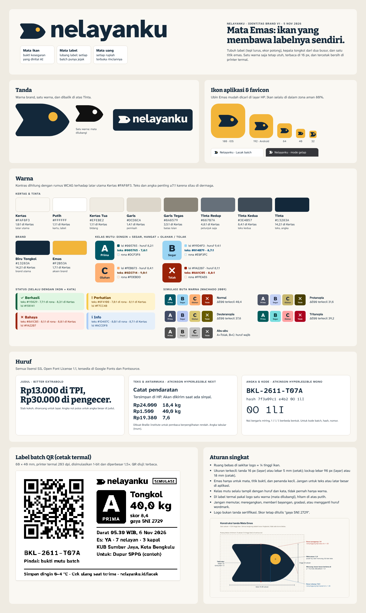
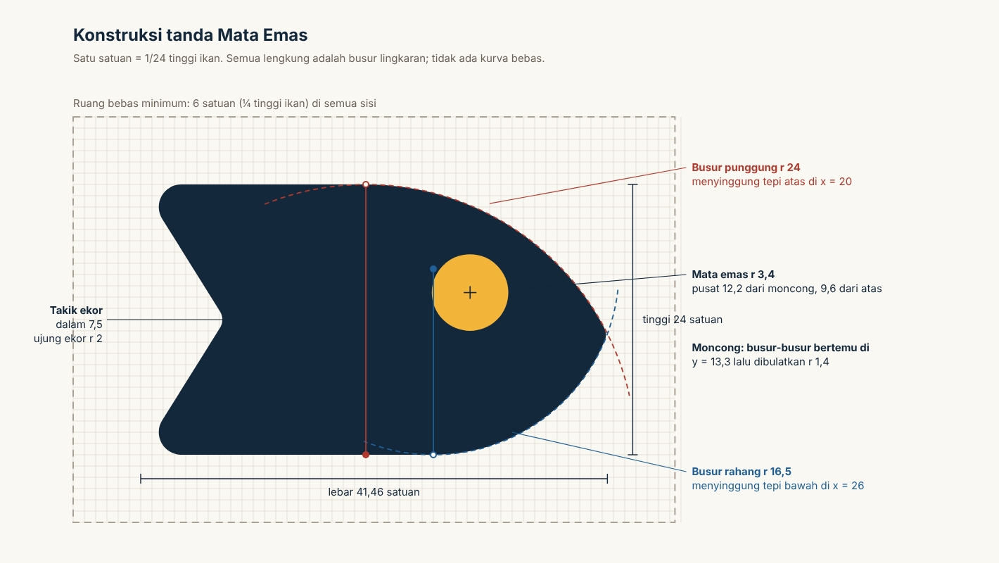
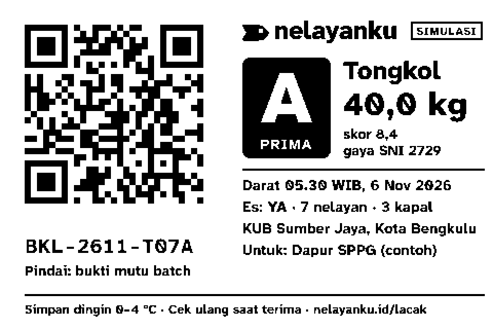

# Brand NELAYANKU

| | |
| :-- | :-- |
| Versi | 1.0 (usulan, keputusan akhir di tangan tim) |
| Tanggal | 5 November 2026 |
| Berkas utama | `brand/brand-board.png` (lihat ini dulu), `brand/svg/*.svg`, ikon aplikasi di `public/brand/` dan `src/app/` |
| Dokumen terkait | `docs/PRD.md` §12 (UX & aksesibilitas), `docs/MODEL_BISNIS.md` §10 (nama) |

Cara membaca: bagian 1 untuk keputusan nama, bagian 2 untuk cara bicara, bagian 3–6 untuk logo, warna, huruf, dan label. Semua angka kontras dan uji buta warna dihitung dengan skrip, bukan ditebak. Hasil angkanya ada di `brand/palet-kontras.json`.

---

## Ringkasan

- **Nama:** pakai **NELAYANKU** untuk IT RUSH 2026. Kalau produk berlanjut setelah lomba, nama terbaik untuk diuji adalah **Sandar**. Shortlist lengkap: Sandar, Utuh, Seperahu, Ikan Kito.
- **Tanda "Mata Emas":** ikan yang dibentuk seperti label (tepi lurus, ekor potong) dengan satu mata emas. Dalam bahasa kita, *mata* punya tiga arti yang semuanya inti produk ini: **mata ikan** (bukti kesegaran), **mata label** (lubang label, jejak setiap kiriman), dan **mata uang** (setiap rupiah terbuka rinciannya).
- **Warna:** Tinta (#13283A) di atas Kertas (#FAF8F3), satu aksen Emas (#F2B53A). Kelas mutu: **dingin = segar** (A biru laut, B biru es), **hangat = olahan atau tolak** (C jingga, Tolak merah karat). Semua teks ≥7:1.
- **Huruf:** Atkinson Hyperlegible Next (teks), Bitter (judul), Atkinson Hyperlegible Mono (angka dan kode). Semuanya OFL 1.1.
- **Suara:** jujur, terbuka, kokoh, hangat, hemat kata. Bahasa sehari-hari tanpa istilah Inggris.

---

## 1. Nama

### 1.1 Kriteria

Setiap kriteria dinilai 1–5. Totalnya maksimal 25.

| Kriteria | Nilai 5 berarti | Nilai 1 berarti |
| :-- | :-- | :-- |
| **Makna** | Menggambarkan kebenaran produk: dermaga, mutu, bayar adil, tidak terbuang, bersama | Tidak ada hubungan, atau maknanya menyesatkan |
| **Ingat** | Pendek, khas, mudah diingat setelah sekali dengar | Generik atau mudah tertukar |
| **Ucap** | Kata sehari-hari, mudah diucap Bu Sari, Pak Darman, Bu Yanti | Kata formal, asing, atau cara bacanya bisa salah |
| **Beda** | Tidak mirip aplikasi perikanan atau program pemerintah yang sudah ada | Sudah dipakai, atau mirip program/merek lain |
| **Domain** | .id, .co.id, .com, dan .app masih kosong, dan tidak ada aplikasi bernama sama | Domain utama sudah terdaftar dan dipakai |

### 1.2 Alternatif yang dinilai

Status domain dicek lewat RDAP (PANDI untuk .id/.co.id, Verisign untuk .com, Google Registry untuk .app) pada 5 November 2026. "Kosong" berarti belum terdaftar.

| Nama | Arti dan alasan | Makna | Ingat | Ucap | Beda | Domain | **Total** | Hasil cek |
| :-- | :-- | :-: | :-: | :-: | :-: | :-: | :-: | :-- |
| NELAYANKU (sekarang) | "nelayanku": langsung menyebut siapa yang dibela | 3 | 3 | 5 | 3 | 5 | **19** | Keempat domain kosong. Tidak ada aplikasi bernama sama di Play Store. Pola "-ku" sangat umum. |
| **Sandar** | Kapal *sandar* di dermaga, saat aplikasi ini dipakai. "Tempat bersandar" = tempat yang bisa diandalkan. | 5 | 4 | 5 | 5 | 3 | **22** | sandar.id terdaftar 2024 (tanpa situs). sandar.co.id dan sandar.app kosong. Tidak ada di Play Store. |
| **Utuh** | Tidak ada yang terbuang. Ikan utuh. Data utuh (hash audit). Juga bagian dari standar pangan ASUH. | 5 | 4 | 5 | 4 | 4 | **22** | utuh.id kosong, utuh.com terdaftar. "Utuh" juga nama panggilan Banjar. |
| **Seperahu** | "Satu perahu": senasib, termasuk toke dan pembeli. Cocok dengan prinsip "bukan memotong toke". | 4 | 4 | 4 | 5 | 5 | **22** | Keempat domain kosong. Tidak ada di Play Store. Empat suku kata. |
| **Ikan Kito** | "Ikan kita" dalam Melayu Bengkulu (*kito* = kita, dicek dari cerita anak berbahasa Bengkulu) | 4 | 4 | 5 | 4 | 5 | **22** | Keempat domain kosong. *Kito* juga khas Palembang ("wong kito"). Terdengar seperti nama toko ikan. |
| Serenteng | Satu untai ikan = satu kiriman gabungan banyak nelayan | 4 | 3 | 4 | 5 | 5 | **21** | Keempat domain kosong. Kata agak jarang. |
| Timbang Adil | Timbangan yang adil | 4 | 3 | 5 | 4 | 5 | **21** | Domain kosong. Terlalu mirip slogan. Ada aplikasi "ADIL" milik partai di Malaysia. |
| Laut Kito | "Laut kita" (Melayu Bengkulu) | 3 | 4 | 5 | 4 | 5 | **21** | Domain kosong. Lebih soal laut daripada dagang ikan. |
| Labuh | Berlabuh, tempat berlabuh | 3 | 4 | 4 | 4 | 4 | **19** | labuh.id kosong. "Labuhan" juga upacara sesaji laut di Jawa. |
| Tambat | Menambat perahu | 4 | 3 | 5 | 3 | 4 | **19** | "Tambatan perahu" adalah istilah fasilitas KNMP, jadi terasa program pemerintah. |
| Renteng | Ikan *direnteng* (diuntai); "tanggung renteng" koperasi | 4 | 4 | 4 | 3 | 4 | **19** | Tanggung renteng = pinjaman kelompok, bertentangan dengan prinsip "tidak meminjamkan uang". "Renteng" juga sachet warung. |
| Biduk | Perahu kecil, cocok dengan "nelayan kecil" | 4 | 4 | 5 | 2 | 4 | **19** | Ada aplikasi kurir "Biduk Shipping World". "Biduk rumah tangga" = ungkapan pernikahan di berita. |
| Patut | Harga yang patut | 4 | 3 | 5 | 3 | 4 | **19** | "Patut Patuh Patju" adalah semboyan resmi Kabupaten Lombok Barat, juga nama aplikasi rumah sakit. |
| Awak | Awak kapal; "kita" (dialek Kaur) | 4 | 4 | 5 | 2 | 3 | **18** | Ada aplikasi "AWAK" di Play Store. Di Malaysia *awak* = "kamu", jadi maknanya bisa tertukar. |
| Sepadan | Harga sepadan dengan mutu (tesis produk) | 5 | 3 | 4 | 4 | 2 | **18** | sepadan.id dan .co.id sudah terdaftar. Kata agak formal. |
| Jernih | Mata ikan jernih; hitungan jernih | 5 | 4 | 4 | 2 | 2 | **17** | jernih.id = portal berita Jambi. Ada aplikasi "Jernih.ID". |
| Terang | "Titik terang"; terang-terangan | 5 | 4 | 5 | 2 | 1 | **17** | .id, .co.id, .com terdaftar. Nama umum (banyak aplikasi senter). |
| Timbang | Menimbang ikan, menimbang dengan adil | 4 | 4 | 5 | 2 | 2 | **17** | timbang.id aktif: produk edukasi keuangan bernama "Timbang". |
| Lunas | Dibayar lunas, sekaligus *lunas* = tulang lunas perahu | 4 | 5 | 5 | 2 | 1 | **17** | Keempat domain terdaftar. Bertabrakan dengan status "lunas" di aplikasi. Bernuansa penagihan utang. |
| Sauh | Jangkar | 3 | 3 | 3 | 4 | 4 | **17** | Jangkar sudah ada di logo KKP. Kata kurang dikenal. |
| Simpul | Simpul jaring; titik temu | 4 | 3 | 5 | 3 | 1 | **16** | Keempat domain terdaftar. |

Dibuang sebelum dinilai: **Tuiri** (artinya tidak bisa dibuktikan; di web hanya muncul sebagai nama kerupuk), **Jaring** (jaring.id sudah aktif dipakai situs bernama "Jaring"), awalan **Mina-** (Minapoli sudah ada, dan "minapolitan" adalah program KKP), **Kongsi**, **Neraca**, **Tera** (domain terdaftar dan maknanya generik), **Pelantar** (Melayu Riau, kurang dikenal di Bengkulu), **Tangkahan** (identik dengan dermaga milik toke).

### 1.3 Shortlist

1. **Sandar.** Paling tepat dengan momen produk: kapal sandar pukul 05.30, lalu ikan ditimbang dan dinilai. "Tempat bersandar" memberi rasa percaya tanpa terdengar seperti program bantuan. Kata sehari-hari, dua suku kata. **Risiko:** sandar.id sudah terdaftar (belum dipakai). Pakai sandar.app, atau sandar.co.id kalau KUB/perusahaan sudah berbadan hukum.
2. **Utuh.** Paling dekat dengan janji "tanpa ada yang terbuang": ikan grade C tetap diolah, data tidak bisa diubah diam-diam. **Risiko:** abstrak, jadi selalu butuh keterangan ("Utuh, buku kerja KUB nelayan").
3. **Seperahu.** Paling hangat, dan mengajak toke serta pembeli ikut "satu perahu". Semua domain kosong. **Risiko:** empat suku kata, sedikit sentimental, dan menggoda desainer memakai gambar perahu yang klise.
4. **Ikan Kito.** Paling lokal, dan bisa jadi kebanggaan di lomba yang diadakan Universitas Bengkulu. **Risiko:** terdengar seperti toko ikan untuk konsumen, padahal produk ini B2B. Kurang jelas bagi juri di luar Sumatra.

### 1.4 Penilaian jujur untuk NELAYANKU

**Rekomendasi: tetap pakai NELAYANKU untuk lomba.**

Alasan mempertahankan:
- Juri dan nelayan langsung paham produk ini untuk siapa.
- Keempat domain masih kosong. Tidak ada aplikasi, startup, atau program bernama sama yang ditemukan.
- Dokumen, akun demo (`operator@demo.nelayanku.id`), dan sistem brand ini sudah memakainya. Mengganti nama di tengah 16 hari pengembangan memakan waktu yang lebih baik dipakai untuk fitur.

Kelemahan yang perlu diakui:
- Pola "-ku" sangat umum di aplikasi pemerintah daerah, jadi kurang khas.
- Nama ini menonjolkan nelayan, padahal pengguna hariannya operator KUB (sering istri nelayan) dan pengolah.
- Nama ini tidak menyebut mutu, keadilan, atau "tidak terbuang".
- Ditulis kapital semua (NELAYANKU), kesannya seperti program dinas.

Cara menambal kelemahan: wordmark ditulis huruf kecil (**nelayanku**). Dalam kalimat ditulis **Nelayanku**. Tanda Mata Emas yang membawa cerita mutu dan keadilan. Setelah lomba, cek PDKI lalu uji **Sandar** dengan 3–5 operator KUB.

### 1.5 Yang sudah dan belum dicek

| Sudah dicek | Belum bisa dicek |
| :-- | :-- |
| Pencarian web untuk setiap nama + "aplikasi/startup/nelayan" | **PDKI** (pangkalan data merek DJKI): situs memerlukan JavaScript dan login |
| Status domain lewat RDAP: .id, .co.id, .com, .app | Handle Instagram dan TikTok: memerlukan login |
| Hasil pencarian Google Play. Diakses dari server di luar Indonesia, jadi hasil di HP Indonesia bisa berbeda. | App Store |
| Arti *kito* dalam Melayu Bengkulu | Kosakata Rejang dan Serawai pesisir: tidak ada sumber yang bisa diverifikasi, jadi tidak dipakai |

### 1.6 Catatan kecil soal kata "terukur"

Di dunia perikanan, kata *terukur* melekat pada kebijakan KKP **Penangkapan Ikan Terukur (PIT)** berbasis kuota, yang dikritik organisasi nelayan kecil seperti KIARA karena dianggap berpihak pada industri besar. Kalimat jualan "mutu terukur" tidak salah, tapi bisa memancing asosiasi itu. Di layar aplikasi, pakai "mutu terbukti" atau "mutu yang bisa dicek". Untuk kalimat jualan, keputusannya di tangan tim.

---

## 2. Platform brand

### 2.1 Posisi

> **Nelayanku adalah buku kerja dermaga untuk KUB dan koperasi nelayan kecil: mutu ikan dibuktikan saat mendarat dan setiap rupiah dibuka rinciannya, sehingga pembeli institusi mau membeli langsung, nelayan dibayar adil, dan ikan bermutu rendah tetap terolah.**

Kalimat pendek untuk juri: *Bukan aplikasi jual ikan ke konsumen, dan bukan sekadar AI cek kesegaran. Nelayanku menyambungkan mutu, pesanan, dan pembayaran dalam satu alur.*

### 2.2 Kepribadian

| Nelayanku adalah… | …tapi bukan |
| :-- | :-- |
| **Jujur.** Setiap angka punya sumber dan tanggal. Batas AI ditulis terang ("skor gaya SNI, 4 dari 6 parameter"). | **Sok pintar.** Tidak menjual "AI canggih" atau "akurasi 99%". |
| **Terbuka.** Rincian harga dan potongan bisa dibuka oleh orang yang berhak. | **Mengintip.** Tidak mempermalukan nelayan soal utang. Halaman publik tidak memuat nama asli. |
| **Kokoh.** Tahan dermaga: tombol besar, kontras tinggi, jalan tanpa sinyal, tercetak bersih di printer murah. | **Kaku.** Tidak berbahasa dinas dan tidak bergaya aplikasi pemerintah. |
| **Hangat.** Bicara seperti tetangga di koperasi, menyebut nama orang. | **Iba.** Tidak menggambarkan nelayan sebagai korban yang perlu dikasihani. |
| **Hemat kata.** Satu layar satu tugas, angka didahulukan. | **Dingin.** Kalimat pendek tetap sopan dan selalu memberi tahu langkah berikutnya. |

### 2.3 Suara dan nada

**Prinsip menulis teks di layar**
1. **Kata kerja di depan, satu perintah per kalimat.** "Foto mata ikan." "Simpan." "Kirim ringkasan ke WhatsApp."
2. **Angka dulu, penjelasan sesudahnya.** "18,4 kg · Mutu A · Rp287.000."
3. **Kalimat pendek.** Di layar dermaga paling banyak sekitar 12 kata per kalimat.
4. **Tanpa istilah Inggris** (PRD §12). Lihat daftar kata di bawah.
5. **Hindari kata ganti.** Pakai kalimat perintah sopan. Jangan pakai "kamu". Di WhatsApp, sebut nama dengan Pak/Bu ("Pak Darman, …").
6. **Sebut sumber dan tanggal** untuk setiap harga acuan.
7. **Saat ada masalah, katakan apa yang terjadi dan apa yang harus dilakukan.** Jangan menyalahkan pengguna.
8. **Format Indonesia:** Rp19.380, 18,4 kg, 05.30 WIB, 6 Nov 2026.

**Daftar kata**

| Jangan tulis | Tulis |
| :-- | :-- |
| grading, grade | cek mutu, mutu ("Mutu A · Prima") |
| batch, kode batch | kiriman, kode kiriman (nama `batch` tetap boleh di kode program) |
| pre-order H-1 | pesanan untuk besok |
| dashboard | ringkasan |
| login / logout | masuk / keluar |
| upload / download | unggah / unduh |
| scan | pindai |
| offline / online | tanpa sinyal / ada sinyal |
| sync, sinkronisasi | dikirim saat ada sinyal |
| hash audit | kode bukti |
| price waterfall | rincian harga |
| HPP | modal per bungkus |
| caption | tulisan jualan |
| reset | kembalikan ke awal |
| utang (di layar nelayan) | pinjaman (netral, tetap jujur) |

**Nada per situasi**

| Situasi | Nada | Contoh |
| :-- | :-- | :-- |
| Dermaga (operator, nelayan) | Pendek, perintah, angka besar | "Foto insang. Buka tutup insang dulu." |
| Pembeli institusi | Lengkap, rapi, siap jadi dokumen | "Kiriman BKL-2611-T07A: 40,0 kg tongkol Mutu A, didaratkan 05.30 WIB, dengan es." |
| Halaman depan dan juri | Jelas dan jujur soal batas | "Model menilai mata dan insang. Bau dan tekstur diisi manusia." |
| Studio UMKM (Bu Yanti) | Hangat, mendorong | "Modal per bungkus Rp6.200. Dengan harga jual Rp9.000, untung Rp2.800 per bungkus." |
| Pesan WhatsApp | Personal, ringkas | "Pak Darman, hari ini Bapak menerima Rp287.000 untuk 18,4 kg tongkol. Rinciannya: …" |

**Contoh tulis dan jangan**

| Tulis | Jangan tulis |
| :-- | :-- |
| Foto mata ikan di dalam lingkaran. | Silakan lakukan capture pada region mata. |
| Tersimpan di HP. Dikirim saat ada sinyal. | Data disimpan offline dan akan disinkronisasi. |
| Foto terlalu gelap. Nyalakan senter, lalu foto lagi. | Error: kualitas gambar rendah. |
| Mutu A · Prima. Skor 8,4 dari 9 (gaya SNI 2729). | AI kami 99% akurat menilai ikan Anda! |
| Harga TPI Pulau Baai, 5 Nov 2026 (PIPP KKP): Rp13.000/kg | Harga pasar: Rp13.000 (tanpa sumber) |
| Potongan pinjaman ke toke Rp50.000. Disetujui Pak Darman. | Utang Anda dipotong otomatis. |
| Bersama nelayan Pulau Baai. | Bantu nelayan miskin. |
| Belum tersimpan. Coba lagi. | Anda gagal menyimpan data. |

---

## 3. Logo



### 3.1 Konsep: Mata Emas

Ikan yang **dibentuk seperti label**:
- **Tepi atas dan bawah lurus** seperti label cetak.
- **Ekor dipotong** seperti ujung pita label.
- **Kepala** tongkol dibentuk dari dua busur.
- Ada **satu mata emas**.

Setiap bagian punya dua bacaan: ekor potong adalah ujung label sekaligus ekor ikan, dan matanya adalah lubang label sekaligus mata ikan.

Ceritanya ada di kata **mata**:
- **Mata ikan.** Yang dinilai AI di dermaga. Pembeli di pasar sudah lama tahu: *mata ikan tidak bisa bohong*.
- **Mata label.** Lubang label yang diikat ke barang, dalam bahasa sehari-hari *mata ayam*. Setiap kiriman punya label dan jejak.
- **Mata uang.** Setiap rupiah dibuka rinciannya dan nelayan dibayar adil.

Warna emas hanya ada di satu titik itu, jadi titik emas menjadi tanda tangan brand. Dalam satu warna, mata dilubangi, sehingga logo tetap utuh di printer termal.

### 3.2 Arah yang dijelajahi

Semua konsep (putaran r1 sampai r9) disimpan di luar repo agar riwayat tetap ringan. Setiap konsep dirender di 16, 32, 64, 180, dan 512 px, dalam satu warna dan warna brand, ditambah simulasi cetak termal 203 dpi (berkas `*-lembar.png`).

| Arah | Ide | 16 px | Label termal | Orisinalitas | Putusan |
| :-- | :-- | :-- | :-- | :-- | :-- |
| Titik Terang (r1) | Mata + garis insang | Terbaca | Bersih | Sedang | Ditolak: terbaca seperti ikon suara/nirsentuh, bukan ikan |
| Kepala dalam bingkai (r1) | Kepala ikan terpotong bingkai foto | Sangat jelas | Sangat bersih | Rendah–sedang | Dikembangkan |
| Label ikan (r1) | Label = ikan, lubang = mata | Sangat jelas | Sangat bersih | Rendah | Dikembangkan |
| Label gantung (r1) | Label tegak, ikan digantung | Jelas | Bersih | Rendah | Ditolak: terbaca panah, pensil, atau penanda buku |
| Simpul jaring (r1) | Mata jaring dan simpulnya | Jadi bintik | Cukup | Rendah | Ditolak: seperti ikon "jaringan" |
| N dermaga (r1) | Tiang dan penyangga dermaga = N | Jelas | Bersih | Rendah | Ditolak: mirip N Netflix |
| Mata QR (r1) | Penanda sudut QR = mata | Jelas | Bersih | Rendah | Ditolak: mirip ikon Instagram/kamera, bisa mengganggu pemindai QR |
| Mata jaring (r2) | Mata ikan di dalam belah ketupat | Sedang | Bersih | Rendah | Ditolak: seperti ikon "lihat sandi" atau pengawasan |
| Garis cakalang (r2) | Garis perut = baris rincian | Buruk | Buruk | Sedang | Ditolak: berantakan |
| Kepala menghadap kanan (r2–r3) | Kepala + mata emas | Jelas | Bersih | Sedang | Ditolak di lockup: terbaca huruf "D" atau "I(" |
| Label berhidung lancip (r4) | Label klasik + takik | Jelas | Bersih | Rendah | Ditolak: hampir sama dengan ikon Material "label_important" |
| **Label ikan Mata Emas (r5–r8)** | Tepi lurus, kepala tongkol, ekor potong, mata emas | Jelas | Sangat bersih | Sedang–baik | **Dipilih**, lalu disempurnakan 4 putaran |

Putaran penyempurnaan:
- **r5:** bentuk kepala (setengah lingkaran, ogive, hidung label, moncong tongkol).
- **r6:** kurva bebas. Ujung moncong menjadi lancip seperti peluru.
- **r7:** kepala kerucut dari poligon. Hasilnya bersegi dan kasar. Takik insang di tepi atas dan bawah juga dicoba, tapi terlihat seperti gigitan.
- **r8:** **busur lingkaran** yang menyinggung tepi label. Hasilnya halus dan bisa diukur, jadi dipakai.
- **r9:** perataan lockup (duduk di garis dasar vs. di tengah tinggi-x). Dipilih: di tengah tinggi-x.

### 3.3 Beda dengan pemain lain

| Pembanding | Tanda mereka (dilihat atau dari deskripsi resmi) | Tanda kita |
| :-- | :-- | :-- |
| Aruna | Huruf "a" biru yang menyerupai ikan, di kotak biru | Bukan huruf. Warna tinta + emas, tanpa biru terang. |
| eFishery | Ikan melingkar membentuk lingkaran (deskripsi merek dagang AS) | Ikan lurus, tanpa lingkaran |
| Fishku | Lingkaran biru tua berisi huruf S/$ | Tanpa lingkaran dan tanpa huruf |
| KKP | Lingkaran sulur biru bergradasi dengan Garuda | Tanpa gradasi, tanpa lambang negara, tanpa sulur |
| Kampung Nelayan Merah Putih | Logo resmi tidak ditemukan; identitasnya merah-putih | Tidak memakai pasangan merah-putih. Merah hanya untuk Tolak dan Bahaya. |

### 3.4 Konstruksi



- **Satuan:** 1 satuan = 1/24 tinggi ikan. Tinggi 24, lebar konstruksi 41,46. Tinta sebenarnya dari x ≈ 1,61 sampai 41,33, karena sudut dibulatkan. `viewBox` tanda mengikuti batas tinta ini.
- **Tubuh:** tepi atas dan bawah lurus dan sejajar (sisi label).
- **Busur punggung:** jari-jari 24, menyinggung tepi atas di x = 20 (pusat di 20, 24).
- **Busur rahang:** jari-jari 16,5, menyinggung tepi bawah di x = 26 (pusat di 26, 7,5). Rahang lebih pendek dari punggung, seperti kepala tongkol.
- **Moncong:** kedua busur bertemu di y = 13,3 (sedikit di bawah tengah = mulut), lalu dibulatkan dengan jari-jari 1,4.
- **Ekor:** takik sedalam 7,5 di tengah. Ujung ekor dibulatkan 2, sudut dalam takik 1,4.
- **Mata:** lingkaran berjari-jari 3,4, berpusat 12,2 dari moncong dan 9,6 dari tepi atas.
- Semua lengkung adalah busur lingkaran. Tidak ada kurva bebas, jadi bentuk bisa dibuat ulang persis.

### 3.5 Lockup

- Ikan selalu **di kiri dan menghadap kanan**, menatap ke arah baca.
- **Tinggi ikan = 1,25 × tinggi-x** wordmark, diletakkan **di tengah tinggi-x**.
- **Jarak ikan ke huruf n = 9 satuan** (9/24 tinggi ikan).
- **Wordmark:** "nelayanku", huruf kecil, dari **Atkinson Hyperlegible Next ExtraBold** yang sudah diubah menjadi garis (path).
  - Spasi dirapatkan −18/1000 em.
  - Kerning manual: e-l −6, l-a +4, a-y −14, y-a −14, k-u −4.
  - Kaki melengkung pada huruf **l** sengaja dipertahankan, karena itulah yang membedakan l dari I dan 1. Ini sesuai janji keterbacaan brand.

### 3.6 Ruang bebas dan ukuran minimum

- **Ruang bebas:** 6 satuan (¼ tinggi ikan) di semua sisi tanda dan lockup. Tidak boleh ada teks, garis, atau tepi kertas di dalamnya.
- **Ukuran terkecil:**

| Versi | Layar | Cetak (termal 203 dpi) |
| :-- | :-- | :-- |
| Tanda | lebar 16 px (≤32 px pakai `favicon.svg`) | lebar 5 mm (40 titik) |
| Lockup | lebar 96 px | lebar 18 mm (144 titik), sudah diuji di label contoh |

### 3.7 Versi logo

| Berkas | Warna | Dipakai di |
| :-- | :-- | :-- |
| `logo-lockup.svg` | Tinta + mata Emas (`currentColor`, bawaan #13283A) | Kertas, Putih, bidang terang |
| `logo-mono.svg` | Satu warna `currentColor`, mata dilubangi | Label termal (hitam), dibalik di atas Tinta (warna Kertas), di atas Emas (warna Tinta) |
| `logo-mark.svg` | Ikan Tinta + mata Emas | Avatar, stempel kecil, header sempit |
| `logo-mark-mono.svg` | Satu warna, mata dilubangi | Cetak satu warna, stempel karet, emboss |
| `logo-wordmark.svg` | Huruf saja (`currentColor`) | Bila tanda sudah tampil di dekatnya |

### 3.8 Ikon aplikasi dan favicon

- **`app-icon.svg` / `app-icon-512.png` / `app-icon-192.png`:** ubin **Emas** penuh, ikan **Tinta**, mata dilubangi sehingga emas terlihat.
  - Ubin emas dipilih setelah diuji di layar HP tiruan: paling mudah dicari di antara ikon biru, hijau, dan merah. Ubin tinta dengan ikan krem juga diuji, tapi kesannya mirip telur ceplok.
  - Ikan selebar 304 px dengan diagonal 351 px, jadi masih di dalam lingkaran aman 80% (410 px) untuk ikon *maskable*.
  - Ikan diletakkan di antara titik berat bentuk dan tengah kotak, supaya terlihat seimbang walaupun ada takik di kiri.
- **`apple-touch-icon-180.png`:** sama, tanpa transparansi. iOS membulatkan sudutnya sendiri.
- **`favicon.svg`:** ikan versi pendek dengan mata lebih besar dan takik lebih dalam, khusus untuk 16–32 px. Warnanya berganti otomatis: ikan Tinta di tab terang, ikan Kertas di tab gelap (`prefers-color-scheme`, sudah diuji).
- **`favicon-32.png`:** untuk browser yang tidak membaca favicon SVG (misalnya Safari). Isinya ubin Emas dengan ikan Tinta, supaya tetap terlihat di tab gelap.

### 3.9 Lakukan dan jangan (logo)

| Lakukan | Jangan |
| :-- | :-- |
| Pakai berkas SVG asli dari `brand/svg/` | Menggambar ulang, menjiplak, atau mengetik ulang wordmark dengan font |
| Beri ruang bebas ¼ tinggi ikan | Memutar, memiringkan, membalik arah ikan, atau meregangkan |
| Pakai `logo-mono.svg` hitam untuk label termal | Memberi bayangan, gradasi, garis tepi, atau efek 3D |
| Letakkan di Kertas, Putih, Tinta, atau Emas | Memasukkan ikan ke dalam lingkaran (mirip eFishery/KKP) |
| Mata selalu Emas di versi berwarna | Mengganti warna mata (merah, biru, dll.) atau menambah pupil |
| Tulis "Nelayanku" di dalam kalimat | Menulis logo dengan huruf kapital semua |
| Taruh di atas bidang polos | Menaruh di atas foto ramai tanpa bidang polos |
| Sebut skor sebagai "gaya SNI 2729" | Membuat logo terlihat seperti tanda sertifikasi (SNI, Halal) |

---

## 4. Warna

Latar utama: **Kertas #FAF8F3**. Kontras dihitung dengan rumus WCAG 2.x. Hasil lengkapnya ada di `brand/palet-kontras.json`. Target dari PRD §12: **teks dan angka penting ≥7:1** karena silau di dermaga.

### 4.1 Dasar dan brand

| Nama | Hex | Peran | Kontras di Kertas |
| :-- | :-- | :-- | --: |
| Kertas | `#FAF8F3` | Latar utama | 1,0:1 |
| Putih | `#FFFFFF` | Kartu, kolom isian, label cetak | 1,06:1 |
| Kertas Tua | `#EFEBE2` | Bidang pemisah, baris tabel selang-seling | 1,12:1 |
| Garis | `#DCD6CA` | Garis pemisah (hiasan saja) | 1,36:1 |
| Garis Tegas | `#8A8579` | Batas kolom isian dan tombol garis (≥3:1 untuk komponen) | 3,46:1 |
| **Tinta** | `#13283A` | Teks utama, angka penting, logo | **14,21:1** |
| **Tinta Kedua** | `#3E4B57` | Teks kedua, keterangan | **8,42:1** |
| Tinta Redup | `#66707A` | Petunjuk di kolom kosong dan tombol nonaktif saja. **Tidak untuk angka dan instruksi.** | 4,75:1 |
| **Biru Tongkol** (brand utama) | `#13283A` | Logo, tombol utama, tautan. Sama dengan Tinta, karena brand ini memang hitam di atas putih. | **14,21:1** |
| **Emas** (aksen brand) | `#F2B53A` | Mata logo, ikon aplikasi, titik "bukti", penanda aktif. **Tidak untuk teks.** Teks Tinta di atas Emas = 8,22:1. | 1,73:1 |

Teks putih di atas tombol Biru Tongkol = 15,08:1.

### 4.2 Kelas mutu

Logikanya: **dingin = segar** (ikan disimpan di es), **hangat = diolah atau ditolak** (ikan asin dijemur; merah berarti berhenti).

| Kelas | Isi lencana | Huruf di lencana | Tinta (teks di Kertas) | Rona (latar terang) |
| :-- | :-- | :-- | :-- | :-- |
| **A · Prima** | `#005765` biru laut dalam | putih, **8,23:1** | `#005765`, **7,76:1** | `#DCF3F8` (tinta di rona 7,14:1) |
| **B · Segar** | `#99D4F3` biru es | Tinta, **9,38:1** | `#014B79`, **8,66:1** | `#E0F3FC` (8,05:1) |
| **C · Olahan** | `#FEB073` jingga jemur | Tinta, **8,38:1** | `#6D3714`, **8,97:1** | `#FDEBDD` (8,20:1) |
| **Tolak** | `#9A2207` merah karat | putih, **8,06:1** | `#8A1C05`, **8,80:1** | `#FFEAE6` (8,08:1) |

### 4.3 Status

| Status | Isi | Teks di isi | Tinta (di Kertas) | Rona (tinta di rona) |
| :-- | :-- | :-- | :-- | :-- |
| ✓ Berhasil | `#156141` | putih 7,45:1 | `#115629`, 8,29:1 | `#DFF6E2` (7,72:1) |
| ! Perhatian | `#F7CC4B` kuning rambu | Tinta 9,84:1 | `#6F4100`, 8,14:1 | `#FEF3CD` (7,78:1) |
| ✕ Bahaya | `#9A2207` | putih 8,06:1 | `#8A1C05`, 8,80:1 | `#FFEAE6` (8,08:1) |
| i Info | `#ACCDF8` | Tinta 9,22:1 | `#1D487C`, 8,72:1 | `#E5EFFA` (7,95:1) |

Perhatian memakai kuning dengan teks hitam, sama seperti rambu peringatan di jalan, jadi langsung dikenali.

### 4.4 Uji buta warna

**Metode.** Warna isi lencana disimulasikan dengan matriks Machado, Oliveira & Fernandes (2009) pada keparahan penuh, di ruang sRGB linear. Lalu dihitung beda warna CIEDE2000 (ΔE00) antar-pasangan. Beda di atas 10 terlihat jelas berbeda. Gambar lencana yang sungguhan juga disimulasikan per piksel (potongannya ada di papan brand).

| Penglihatan | Kelas mutu: ΔE00 terkecil | Pasangan terdekat | Status: ΔE00 terkecil | Pasangan terdekat |
| :-- | --: | :-- | --: | :-- |
| Normal | 40,4 | B vs C | 50,1 | Perhatian vs Info |
| **Protanopia** | **31,6** | A vs Tolak | 12,6 | Berhasil vs Bahaya |
| **Deuteranopia** | **37,6** | C vs Tolak | 16,4 | Berhasil vs Bahaya |
| Tritanopia | 39,2 | C vs Tolak | 38,7 | Perhatian vs Info |
| Abu-abu (tanpa warna sama sekali) | 0,3 | A vs Tolak | 1,7 | Berhasil vs Bahaya |

**Hasil:**
- Keempat warna kelas mutu **tetap jelas berbeda** bagi protanopia dan deuteranopia. Yang paling dekat masih ΔE00 31,6.
- Polanya kokoh karena dua lencana gelap (A, Tolak) dan dua lencana terang (B, C).
  - Yang terangnya sama dibedakan oleh sumbu biru-kuning. Sumbu ini tetap terlihat oleh penderita buta warna merah-hijau.
  - Yang hue-nya mirip di mata buta warna dibedakan oleh terang-gelap.
- Dalam **abu-abu**, A sama dengan Tolak dan B hampir sama dengan C. Karena itu **huruf dan kata wajib**, persis seperti yang sudah ditetapkan PRD. Ini juga yang terjadi di label termal.
- Status bagi protanopia dan deuteranopia: Berhasil vs Bahaya masih jelas berbeda (ΔE00 12,6). Status juga selalu tampil dengan ikon ✓ ! ✕ i dan kata.

### 4.5 Aturan pakai warna

- Teks utama memakai Tinta. Keterangan memakai Tinta Kedua. Jangan pernah memakai abu-abu muda untuk angka.
- Emas hanya untuk titik kecil: mata, titik bukti, penanda aktif, ikon aplikasi. Jangan untuk latar luas di aplikasi, karena bisa tertukar dengan Perhatian.
- Lencana terang (B, C, Perhatian, Info) di atas Kertas diberi garis tepi 1 px warna tintanya, supaya bentuknya tetap terlihat di bawah matahari.
- Kelas mutu selalu tampil dengan huruf dan kata. Status selalu dengan ikon dan kata.
- Merah hanya untuk Tolak dan Bahaya. Jangan memakai pasangan merah-putih sebagai warna utama.
- Label termal hitam saja. Mutu ditulis dengan huruf besar dan kata ("A · PRIMA").

### 4.6 Token CSS

```css
:root {
  --kertas: #FAF8F3;
  --putih: #FFFFFF;
  --kertas-tua: #EFEBE2;
  --garis: #DCD6CA;
  --garis-tegas: #8A8579;
  --tinta: #13283A;
  --tinta-kedua: #3E4B57;
  --tinta-redup: #66707A;
  --brand: #13283A;
  --emas: #F2B53A;
  --mutu-a-isi: #005765;
  --mutu-a-tinta: #005765;
  --mutu-a-rona: #DCF3F8;
  --mutu-b-isi: #99D4F3;
  --mutu-b-tinta: #014B79;
  --mutu-b-rona: #E0F3FC;
  --mutu-c-isi: #FEB073;
  --mutu-c-tinta: #6D3714;
  --mutu-c-rona: #FDEBDD;
  --tolak-isi: #9A2207;
  --tolak-tinta: #8A1C05;
  --tolak-rona: #FFEAE6;
  --berhasil-isi: #156141;
  --berhasil-tinta: #115629;
  --berhasil-rona: #DFF6E2;
  --perhatian-isi: #F7CC4B;
  --perhatian-tinta: #6F4100;
  --perhatian-rona: #FEF3CD;
  --bahaya-isi: #9A2207;
  --bahaya-tinta: #8A1C05;
  --bahaya-rona: #FFEAE6;
  --info-isi: #ACCDF8;
  --info-tinta: #1D487C;
  --info-rona: #E5EFFA;
}
```

---

## 5. Huruf

### 5.1 Rekomendasi

| Peran | Huruf | Kenapa untuk pengguna ini | Lisensi |
| :-- | :-- | :-- | :-- |
| **Teks dan antarmuka** | **Atkinson Hyperlegible Next** (400, 700, 800) | Dibuat Braille Institute untuk pembaca berpenglihatan rendah. I/l/1 dan 0/O dibedakan, bukaan huruf lebar. Cocok untuk HP murah, silau, dan pembaca yang tamat SD. Punya angka tabular (`tnum`) untuk kolom kg dan Rupiah. | OFL 1.1, tanpa Reserved Font Name |
| **Judul** | **Bitter** (700–800) | Slab kokoh yang dirancang untuk layar. Angka nolnya polos, jadi enak untuk angka besar di judul ("Rp13.000 di TPI"). Rasanya seperti papan harga dan nota tercetak, beda dari tampilan startup pada umumnya. | OFL 1.1, Reserved Font Name "Bitter Pro" (hanya mengikat bila file fontnya diubah lalu disebar) |
| **Angka dan kode** | **Atkinson Hyperlegible Mono** (400, 700) | Semua karakter selebar sama (632/1000), jadi otomatis tabular. Nol bergaris miring, dan 1/l/I berbeda bentuk. Untuk kode kiriman, kode bukti (hash), nomor faktur. | OFL 1.1, tanpa Reserved Font Name |

Semuanya ada di Google Fonts dan Fontsource. Lisensi dicek dari berkas `OFL.txt` di repositori google/fonts pada 5 November 2026.

**Yang dipertimbangkan lalu tidak dipilih:**

| Huruf | Alasan |
| :-- | :-- |
| Plus Jakarta Sans | Buatan Indonesia, tapi angka "1"-nya mirip "l": "Rp1.500" terbaca "Rpl.500" |
| Inter | Terlalu generik, dan I/l sama bentuknya tanpa fitur tambahan |
| B612 Mono | Jarak setelah titik terlalu lebar ("Rp19. 380") |
| JetBrains Mono, IBM Plex Mono | Bagus, tapi Atkinson Mono menyatukan keluarga huruf |

### 5.2 Pengaturan

- **Teks isi:** Atkinson Next 400, minimal 16 px, tinggi baris 1,4.
- **Label dan tombol:** Atkinson Next 700.
- **Angka penting:** Atkinson Next 700/800, minimal 28 px, dengan `font-variant-numeric: tabular-nums`.
- **Judul layar di dermaga:** tetap pakai Atkinson Next 700 (paling terbaca).
- **Bitter:** untuk halaman depan, proposal, video, poster, dan judul label kemasan Studio UMKM.
- **Kode kiriman dan hash:** Atkinson Mono. Pisahkan kode dengan tanda hubung (BKL-2611-T07A).
- **Hindari:** huruf kapital untuk kalimat panjang, dan huruf miring untuk informasi penting.
- **Nol bergaris pada Atkinson** adalah ciri yang disengaja. **Uji dengan 3 nelayan.** Kalau membingungkan di angka uang, pakai Bitter untuk angka Rupiah besar (bukan kode).

### 5.3 Wordmark dan lisensinya

Wordmark diambil dari **Atkinson Hyperlegible Next ExtraBold**:
- Bentuk hurufnya diubah menjadi garis (`path`) dengan fontTools.
- Spasinya dirapatkan dan kerningnya diatur manual (bagian 3.5).

**OFL 1.1 mengizinkan font dipakai dan dimodifikasi untuk karya apa pun, termasuk logo.** Yang dilarang hanya menjual file fontnya sendiri. Atkinson Hyperlegible Next tidak punya Reserved Font Name. Usulan baris atribusi untuk README: *"Wordmark memakai bentuk huruf Atkinson Hyperlegible Next (Braille Institute, OFL 1.1)."*

### 5.4 Memasang

Di aplikasi, ketiga huruf dimuat lewat `next/font/google` di `src/app/fonts.ts`. Next.js mengunduhnya saat build dan menyajikannya dari domain sendiri, jadi tidak ada permintaan ke server Google saat aplikasi dipakai.

---

## 6. Label kiriman QR (cetak termal)



- **Ukuran:** 60 × 40 mm (480 × 320 titik di 203 dpi).
- **QR:**
  - Versi 3 dengan koreksi galat M.
  - **6 titik per modul** (0,75 mm), dengan **zona hening 4 modul di dalam label**, karena krat di sekelilingnya bisa gelap.
  - Sudah diuji terbaca dengan zxing-cpp dari hasil simulasi 1-bit, bahkan setelah diperkecil 50% dan diburamkan.
- **Isi label:** logo satu warna, kode kiriman (Atkinson Mono), **mutu sebagai huruf besar + kata** di kotak hitam, jenis ikan, berat, skor "gaya SNI 2729", jam darat, status es, jumlah nelayan, KUB, tujuan, dan baris kaki tentang penyimpanan.
- **Data demo selalu diberi kotak "SIMULASI"** (prinsip PRD: data demo berlabel).
- **Ikan Tolak tidak pernah mendapat label**, karena tidak bisa masuk kiriman (PRD F-13).
- Teks memakai Atkinson Next 700/800. Jangan memakai huruf di bawah 12 titik (sekitar 1,5 mm).

---

## 7. Lakukan dan jangan (ringkas)

| Lakukan | Jangan |
| :-- | :-- |
| Tulis angka dengan sumber dan tanggal | Menulis "prediksi pasti", "AI canggih", "akurasi 99%" |
| Sebut skor "gaya SNI 2729, 4 dari 6 parameter" | Menyebut ikan "bersertifikat SNI" |
| Pakai Tinta untuk teks, ≥16 px | Teks abu-abu muda, teks di atas Emas kecil-kecil |
| Mutu = warna + huruf + kata | Mutu hanya berupa titik warna |
| Satu tugas per layar, tombol ≥56 px | Formulir panjang di layar dermaga |
| Sapa dengan nama di WhatsApp | Memakai "kamu" atau bahasa dinas |
| Tunjukkan nelayan sebagai pelaku | Foto atau kata yang mengasihani |
| Logo satu warna untuk cetak murah | Logo berwarna di printer termal |

---

## 8. Berkas

| Berkas | Isi |
| :-- | :-- |
| `brand/svg/logo-mark.svg` | Tanda saja (ikan Tinta lewat `currentColor` + mata Emas) |
| `brand/svg/logo-mark-mono.svg` | Tanda satu warna, mata dilubangi |
| `brand/svg/logo-wordmark.svg` | Wordmark saja, huruf sudah jadi path |
| `brand/svg/logo-lockup.svg` | Tanda + wordmark mendatar |
| `brand/svg/logo-mono.svg` | Lockup satu warna (`currentColor`) |
| `brand/svg/app-icon.svg` | Ikon 512 × 512 dengan latar Emas |
| `brand/svg/favicon.svg` | Favicon 16–32 px, berganti warna di mode gelap |
| `public/brand/app-icon-512.png`, `app-icon-192.png` | Ikon PWA/Android |
| `src/app/apple-icon.png` | Ikon iOS 180 px |
| `src/app/icon1.svg`, `src/app/icon2.png` | Favicon SVG dan cadangan PNG (ubin Emas) |
| `brand/brand-board.png` | Papan brand 1600 px |
| `brand/palet-kontras.json` | Semua angka kontras dan simulasi buta warna |

Semua SVG sudah diperiksa:
- Ada `viewBox` yang pas dengan tinta.
- Tanpa `<text>`, tanpa gambar raster, tanpa komentar, tanpa mask.
- Simpul sedikit: tanda = 1 path + 1 lingkaran, 349 byte.

Di aplikasi, logo dipakai lewat komponen `src/components/brand/logo.tsx`, dan ikon aplikasi serta manifest dibuat oleh `src/app/manifest.ts`.

---

## 9. Yang belum diverifikasi

- **Merek dagang:**
  - PDKI belum dicek.
  - Kemiripan logo dinilai manual terhadap lima pembanding, tanpa pencarian gambar terbalik.
  - Logo resmi Kampung Nelayan Merah Putih tidak ditemukan.
  - Gambar logo eFishery tidak bisa diunduh (server membatasi), jadi dinilai dari deskripsi merek dagangnya.
- **Nama:**
  - Handle media sosial dan App Store belum dicek.
  - Play Store diakses dari luar Indonesia.
  - "Kosong" di RDAP berarti belum terdaftar per 5 November 2026, bukan jaminan bisa dibeli. Domain .co.id butuh dokumen badan usaha.
- **Bahasa daerah:** kosakata Rejang dan Serawai pesisir belum bisa diverifikasi. Tanyakan ke penutur asli sebelum memakai kata daerah apa pun.
- **Warna:**
  - Simulasi buta warna adalah model, bukan uji dengan orang buta warna.
  - Rumus kontras WCAG tidak menghitung silau matahari di layar HP murah.
  - Uji lapangan di dermaga pagi dan siang.
- **Label:** QR diuji dari simulasi, belum dari printer termal sungguhan dan kertas yang sudah kena air atau es.
- **Huruf:** keterbacaan nol bergaris Atkinson untuk nelayan belum diuji.
