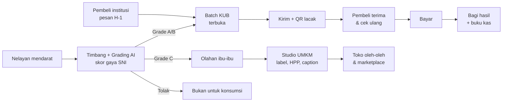
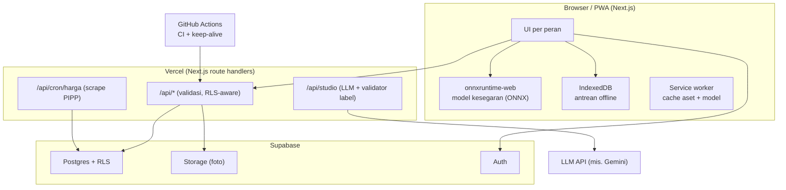

# PRD — NELAYANKU (nama kerja)

| | |
| :-- | :-- |
| Versi | 0.1 (draf untuk ditinjau tim) |
| Tanggal | 4 November 2026 |
| Lomba | IT RUSH 2026, Web Development, subtema **Ekonomi dan Pemberdayaan Masyarakat** |
| Batas kumpul | 20 November 2026, 23.59 WIB |
| Dokumen terkait | `EVALUASI.md` (penilaian ide), `MODEL_BISNIS.md` (pembeli, monetisasi, validasi), `RISET.md` (fakta + sumber), `PANDUAN_LOMBA.md` (aturan) |

Cara membaca: **P0** wajib jadi sebelum fitur lain, **P1** pembeda nilai, **P2** kalau sempat. Setiap fitur punya ID `F-xx` dan kriteria selesai (acceptance criteria). Semua angka yang ditandai **[A]** adalah asumsi yang harus divalidasi.

---

## 1. Ringkasan

NELAYANKU adalah **sistem kerja digital untuk KUB/koperasi nelayan kecil**. Sistem ini membantu mereka menjual tangkapan ke **pembeli institusi** (dapur SPPG program MBG, restoran, hotel, katering) dengan **mutu yang terbukti** dan **pembayaran yang adil dan transparan**.

Di dermaga, operator KUB memotret mata dan insang ikan. **Model AI di browser** (tetap jalan tanpa sinyal) memberi **skor kesegaran bergaya SNI 2729**. Ikan grade A/B mengisi **pesanan yang sudah masuk sehari sebelumnya**. Ikan grade C dialihkan ke **olahan ibu-ibu pesisir**, dan **Studio UMKM** membantu membuat label resmi, menghitung HPP, dan menulis caption jualan. Setiap batch punya **QR lacak**. Setiap rupiah punya **rincian ke mana perginya**.

**Kalimat jualan:** *"Ikan nelayan kecil, mutu terukur, dibayar adil, tanpa ada yang terbuang."*

## 2. Masalah

Semua angka di bawah sudah dicek di sumbernya (lihat `RISET.md`).

- **M1. Nelayan menjual sebagai price taker.** Di Kota Bani (Bengkulu Utara), 90% nelayan menjual ke toke dan menerima harga apa adanya. Tongkol di TPI Pulau Baai Rp13.000/kg, di pengecer Rp30.000/kg, sehingga bagian nelayan hanya sekitar 43%.
- **M2. Utang mengikat penjualan.** Di Seluma, 77,42% nelayan berutang dan 96,77% bergantung pada tengkulak atau pengepul. BBM menyerap lebih dari 60% biaya kapal kecil di Pulau Baai.
- **M3. Ikan harus segera dijual.** 85% nelayan Kota Bani tidak punya cool box. Ikan harus laku saat itu juga ke pembeli terdekat, berapa pun harganya.
- **M4. Mutu tidak terbukti.** Kesegaran dinilai dengan mata pembeli. Pembeli institusi tidak punya bukti mutu dan asal ikan, sehingga menekan harga atau tidak mau membeli langsung dari nelayan.
- **M5. Ikan bermutu rendah kehilangan nilai.** Ikan yang tidak lagi segar dijual sangat murah. Padahal 61% pekerja pascapanen perikanan adalah perempuan yang bisa mengolahnya, tapi kesulitan soal label, izin, harga pokok, dan pemasaran.

**Rumusan masalah (untuk proposal 1.2):**
1. Bagaimana nelayan kecil bisa mendapat harga yang sesuai dengan mutu tangkapannya?
2. Bagaimana mutu ikan bisa dibuktikan secara objektif di dermaga, tanpa alat laboratorium dan tanpa sinyal?
3. Bagaimana tangkapan kecil-kecil bisa digabung untuk memenuhi kebutuhan pembeli institusi sebelum ikan menurun mutunya?
4. Bagaimana ikan bermutu rendah bisa diolah dan dijual dengan nilai tambah oleh perempuan pesisir?

## 3. Solusi dan tesis produk

> **Tesis:** kalau mutu ikan bisa **dibuktikan** di dermaga dan permintaan pembeli institusi **sudah pasti sebelum ikan didaratkan**, maka KUB bisa menjual lebih mahal dari harga TPI, membayar nelayan hari itu juga, dan mengalihkan ikan bermutu rendah ke olahan, sehingga tidak ada yang terbuang.

**Prinsip yang tidak boleh dilanggar**
1. **AI menyarankan, manusia memutuskan.** Skor dan harga adalah saran. Operator dan nelayan selalu bisa menolak atau mengubahnya.
2. **Setiap angka punya asal-usul.** Harga acuan selalu tampil dengan sumber dan tanggal. Data demo diberi label "simulasi".
3. **Bukan memotong toke, tapi membuat semuanya transparan.** Toke boleh ikut sebagai mitra pengumpul. Utang dicatat terbuka dan disetujui nelayan.
4. **Dermaga dulu.** Alur nelayan dan operator harus bisa dipakai dengan tangan basah, di bawah terik matahari atau subuh yang gelap, dengan HP murah, tanpa sinyal.
5. **Pangan aman lebih penting dari penjualan.** Ikan dengan skor di bawah ambang tidak pernah ditawarkan sebagai ikan segar.

## 4. Pengguna dan persona

Semua nama di bawah fiktif.

### 4.1 Operator KUB (pengguna utama), "Bu Sari"
38 tahun, istri nelayan, mengurus administrasi KUB di Kampung Sumber Jaya (Pulau Baai). Lancar memakai WhatsApp dan HP Android kelas menengah.
**JTBD:** *"Saat kapal-kapal anggota mendarat pagi, saya ingin menimbang, menilai, dan memasukkan tangkapan mereka ke pesanan dengan cepat, lalu membagi uangnya dengan adil tanpa ribut."*
**Kebutuhan desain:** satu tugas per layar, target sentuh ≥48 px, kerja tanpa sinyal, rekap otomatis, bisa memakai tablet maupun HP.

### 4.2 Nelayan, "Pak Darman"
44 tahun, nelayan tongkol dengan perahu 3 GT, tamat SD, HP Android murah dengan kuota terbatas. Berutang Rp3 juta ke toke untuk BBM.
**JTBD:** *"Saat saya mendarat, saya ingin tahu ikan saya layak dihargai berapa dan dibayar hari itu juga, tanpa memutus hubungan dengan toke yang meminjami saya modal."*
**Kebutuhan desain:** tidak wajib punya akun. Menerima ringkasan lewat WhatsApp. Kalau membuka aplikasi, isinya hanya angka besar: kg, grade, rupiah, sisa utang.

### 4.3 Pembeli institusi, "Pak Hendra"
Kepala dapur SPPG atau pemilik rumah makan seafood di Kota Bengkulu. Bekerja dari laptop dan HP.
**JTBD:** *"Karena saya harus menyajikan ikan setiap hari, saya ingin pasokan yang mutunya terjamin dan bisa dibuktikan, dengan harga yang stabil, supaya tidak ada keluhan atau masalah keamanan pangan."*
**Kebutuhan desain:** pesan sehari sebelumnya, lihat bukti mutu per batch, cek ulang saat barang tiba, unduh faktur.
**Khusus SPPG** (Peraturan BGN 10/2026, lihat `MODEL_BISNIS.md` §2.1):
- Pemasoknya harus pelaku usaha lokal berbadan hukum (koperasi, KDMP, UMK, BUMDes) dengan NIB dan NPWP.
- Pengadaannya tidak boleh dikenai komisi.
- Anggaran bahan baku Rp8.000–10.000 per porsi.
- Butuh dokumen mutu per batch untuk pemeriksaan bahan baku.

### 4.4 Pengolah UMKM, "Bu Yanti"
41 tahun, membuat ikan asin dan kerupuk ikan, anggota KUB.
**JTBD:** *"Saya ingin mengubah ikan grade rendah jadi produk yang layak dijual di toko oleh-oleh, dengan label resmi dan harga yang menutup modal."*
**Kebutuhan desain:** input suara dan foto, tanpa formulir panjang. Hasilnya bisa dicetak dan dibagikan ke WhatsApp.

### 4.5 Juri (persona bayangan, tapi menentukan nilai)
Dosen informatika, membuka link di laptop, sekitar 5–10 menit per karya, tanpa ikan di tangan dan tanpa kesempatan bertanya.
**JTBD:** *"Dalam 60 detik saya ingin paham masalahnya, melihat AI-nya bekerja, dan bisa mencobanya sendiri."*
**Kebutuhan desain:** coba tanpa login, foto contoh, satu klik masuk per peran, data demo yang hidup.

## 5. Satu hari di Pulau Baai (alur utama)

| Waktu | Siapa | Kejadian | Fitur |
| :-- | :-- | :-- | :-- |
| H-1, 15.00 | Pembeli | Memesan 40 kg tongkol grade A untuk besok pukul 08.00, dengan harga yang disarankan sistem | F-30 |
| H-1, 20.00 | Sistem | Pesanan ditutup, batch dibuka untuk KUB, dan anggota diberi tahu lewat WhatsApp | F-31 |
| 05.30 | Operator | Kapal mendarat: catat nelayan, jenis ikan, berat timbangan, jam darat, status es | F-10 |
| 05.35 | Operator | Foto mata dan insang 3 ikan sampel, lalu 2 ketukan (bau, tekstur). Skor 8,4, grade A. | F-11, F-12 |
| 05.40 | Sistem | Saran: "Masukkan 18 kg ke Batch Tongkol A (22/40 kg)". Rentang harga wajar dan rincian harga tampil. | F-20, F-21, F-32 |
| 07.00 | Operator | Batch penuh: cetak label QR, checklist es, berangkat kirim | F-33, F-40 |
| 08.00 | Pembeli | Pindai QR, lihat bukti mutu, cek ulang 1 ikan, terima batch | F-41 |
| 09.00 | Sistem | Pembayaran (simulasi), bagi hasil per nelayan, potongan utang yang disetujui, kirim ringkasan WA | F-50, F-51, F-52 |
| 10.00 | Operator | Ikan grade C (12 kg) dicatat sebagai bahan olahan untuk Bu Yanti | F-13 |
| Siang | Bu Yanti | Membuat produk "Ikan Asin Tongkol 250 g": HPP, label, caption, cetak | F-60 – F-64 |

## 6. Fitur

### EP-0 · Publik & mode juri

**F-01 · Halaman depan · P0**
Hero berisi masalah dalam angka, alur dalam tiga langkah, tombol **"Coba grading tanpa login"**, dan tombol **"Masuk sebagai…"**.
- [ ] Dalam satu layar laptop, juri melihat masalah, solusi, dan dua tombol aksi.
- [ ] Semua angka di halaman depan mencantumkan sumbernya.

**F-02 · Coba grading tanpa login (`/coba`) · P0**
Enam foto contoh (2 sangat segar, 2 segar, 2 tidak segar), unggah foto sendiri, atau pakai kamera. Hasil skor gaya SNI tampil beserta alasan per parameter.
- [ ] Hasil keluar ≤3 detik di laptop juri tanpa login.
- [ ] Ada tulisan jujur: "Model menilai mata dan insang; bau dan tekstur diisi manusia."

**F-03 · Masuk sebagai peran · P0**
Tombol Operator KUB / Nelayan / Pembeli / UMKM yang langsung masuk ke akun demo berisi data. Akunnya sama dengan yang dicantumkan di proposal.
- [ ] Satu klik, langsung ke dashboard peran tersebut.
- [ ] Tombol **Reset demo** mengembalikan data seed (khusus akun demo).

**F-04 · Halaman lacak publik (`/lacak/[kode]`) · P0**
Bukti mutu batch: jenis ikan, grade, skor per parameter, jam darat, KUB & kabupaten, status es, dan hash audit. Nama nelayan ditampilkan sebagai "Nelayan #12", bukan nama asli.

**F-05 · Halaman model (`/tentang/model`) · P1**
Model card: dataset, akurasi per spesies, confusion matrix, batasan, dan kapan hasilnya tidak boleh dipercaya.

### EP-1 · Pendaratan & grading

**F-10 · Catat pendaratan · P0**
Pilih nelayan (dari daftar bergambar/berinisial), pilih jenis ikan (daftar bergambar), isi berat dengan tombol angka besar, jam darat terisi otomatis, status es (ya/tidak).
- [ ] Selesai ≤20 detik dan ≤5 ketukan.
- [ ] Jalan offline. Data masuk antrean lalu tersinkron otomatis.

**F-11 · Foto terpandu mata & insang · P0**
Kamera dengan lingkaran panduan ("taruh mata ikan di dalam lingkaran") dan kotak panduan untuk insang ("buka tutup insang"). Quality gate di perangkat (buram, gelap, silau) dan tombol senter.
- [ ] Kalau izin kamera ditolak, pindah ke mode unggah dengan pesan jelas.
- [ ] Foto dikompres di perangkat (sisi terpanjang ≤1280 px) sebelum disimpan.

**F-12 · Skor kesegaran gaya SNI · P0**
Model di browser menilai potongan mata dan insang. Dua ketukan besar mengisi bau dan tekstur. Hasilnya skor 1–9 per parameter, skor akhir, grade, dan alasan dalam bahasa sehari-hari. Rumus ada di §10.2.
- [ ] Inferensi ≤1,5 detik per potongan di HP Android kelas menengah [A].
- [ ] Operator bisa mengubah grade dengan alasan, dan perubahannya tercatat di audit.
- [ ] Hash audit (SHA-256 dari JSON kanonik hasil) tersimpan.

**F-13 · Arahkan ke kanal · P0**
Berdasarkan grade: A/B ke batch pesanan atau dijual biasa, C ke bahan olahan, Tolak ke "bukan untuk konsumsi".
- [ ] Ikan dengan grade Tolak tidak bisa dimasukkan ke batch maupun ke olahan.
- [ ] **Aturan histamin:** untuk tongkol, cakalang, dan tuna, ikan tanpa es, atau yang sudah melewati batas jam sejak didaratkan [A], tidak bisa masuk batch SPPG. UI menjelaskan bahwa skor organoleptik tidak mengukur histamin, sehingga rantai dingin menjadi kontrol utamanya.

**F-14 · Mode sampel keranjang · P1**
Satu keranjang dinilai dari 3 ikan sampel. Grade keranjang memakai aturan konservatif (grade terendah dari sampel, atau rata-rata dengan veto).

**F-15 · Deteksi otomatis mata/insang dari foto ikan utuh · P2**
Model deteksi (YOLO) yang memotong area mata dan insang otomatis, jadi tidak perlu bingkai panduan.

### EP-2 · Harga

**F-20 · Harga acuan dengan asal-usul · P0**
Tabel `harga_acuan` per jenis ikan: harga pelabuhan (PIPP KKP) dan harga konsumen (Panel Harga Bapanas), masing-masing dengan sumber dan tanggal.
- [ ] Tidak ada angka tanpa label sumber.
- [ ] P1: scraping terjadwal PIPP (cron harian). Kalau gagal, nilai lama dipertahankan dan kegagalannya dicatat. Sistem tidak pernah mengarang angka.

**F-21 · Rentang harga wajar · P0**
Rentang harga untuk nelayan per grade, dihitung dengan rumus transparan (§11), plus kolom **"tawaran toke hari ini"** untuk dibandingkan.

**F-22 · Rincian harga (price waterfall) · P0**
Untuk setiap batch: harga pembeli → biaya es & angkut → kas KUB → biaya layanan platform → diterima nelayan, dibandingkan dengan harga TPI hari itu.
- [ ] Setiap baris rincian bisa diklik untuk melihat rumus dan sumber angkanya.

**F-23 · Tren harga 30 hari · P1**
Grafik harga acuan 30 hari dengan rata-rata bergerak 7 hari. Diberi label "tren", bukan "prediksi pasti".

### EP-3 · Pesanan & batch

**F-30 · Pesanan H-1 · P0**
Pembeli memesan: jenis ikan, grade minimal, kg, waktu kirim, alamat, harga (disarankan sistem, bisa ditawar). DP dicatat sebagai simulasi.

**F-31 · Tutup pesanan & buka batch · P0**
Pesanan untuk esok pagi ditutup pukul 20.00 [A]. Sistem membuka batch dan mengirim pengumuman ke anggota KUB (P1: lewat tautan WhatsApp).

**F-32 · Isi batch · P0**
Setelah grading, sistem menyarankan batch yang cocok (jenis + grade). Meteran isi tampil ("22/40 kg") dengan daftar kontribusi per nelayan.
- [ ] Batch tidak bisa melebihi target kg tanpa konfirmasi.
- [ ] Batch yang tidak penuh sampai batas waktu memberi pilihan: kirim sebagian, gabung dengan KUB lain (P2), atau jual ke TPI.

**F-33 · Label batch & QR · P0**
Label cetak (A6 atau 4 label per A4) berisi QR ke `/lacak/[kode]`, jenis, grade, berat, dan jam darat.

**F-34 · Jam segar · P0 untuk tongkol, cakalang, dan tuna; P1 untuk jenis lain**
Hitung mundur sejak jam darat, dengan pengingat status es. Batas waktunya diatur per jenis ikan [A] dan divalidasi dengan dosen perikanan.

**F-35 · Kesiapan pemasok SPPG · P1**
Checklist untuk KUB: badan hukum (koperasi, KDMP, atau UMK), NIB, NPWP, sarana higienis, dan kemampuan pasokan rutin. Dilengkapi **dokumen mutu per batch** yang bisa diunduh SPPG: skor per parameter, jam darat, status es, dan hash audit. Ini mendukung pemeriksaan bahan baku di SPPG.

### EP-4 · Pengiriman & penerimaan

**F-40 · Checklist kirim · P0**
Checklist rasio es dan wadah, jam berangkat, kurir. P1: rute jemput dari beberapa titik.

**F-41 · Terima & cek ulang · P0**
Pembeli memindai QR, melihat bukti mutu, opsional memotret satu ikan untuk cek ulang dengan model yang sama, lalu memilih **Terima / Terima sebagian / Tolak** dengan foto bukti.
- [ ] Penolakan tercatat lengkap dengan foto dan skor cek ulang, dan masuk antrean sengketa operator.

### EP-5 · Pembayaran, bagi hasil, buku kas

**F-50 · Pembayaran (simulasi) · P0**
Status pembayaran batch: DP, lunas, terlambat. Pembayaran nyata (transfer/QRIS) berada di luar aplikasi pada versi lomba.

**F-51 · Bagi hasil otomatis · P0**
Per nelayan: kg × harga grade, dikurangi potongan utang yang **disetujui nelayan**, sama dengan yang diterima. Ringkasan dikirim lewat tautan WhatsApp (`wa.me`).

**F-52 · Buku kas nelayan · P0**
Catatan pendapatan, pinjaman, cicilan, dan saldo per nelayan, dengan pihak pemberi pinjaman (toke, koperasi, kerabat). Setiap potongan butuh persetujuan nelayan. Saat online, persetujuan memakai tautan konfirmasi. Saat offline, operator mencentang "disetujui lisan" dan aksi itu tercatat di audit.
- [ ] Nelayan bisa mengunduh **riwayat transaksi PDF**, yang bisa dibawa untuk pengajuan kredit (lihat `MODEL_BISNIS.md`).

**F-53 · Peran mitra pengumpul (toke) · P1**
Toke bisa terdaftar sebagai mitra: melihat batch, ikut mengisi batch dari tangkapan nelayan binaannya, dan pinjamannya tercatat transparan.

### EP-6 · Studio UMKM

**F-60 · Bahan baku dari grade C · P0**
Daftar ikan grade C yang tersedia (jenis, kg, harga olahan). Bisa diambil sebagai bahan baku, dan asal batch tercatat.

**F-61 · Buat produk lewat suara/foto · P0**
Ucapkan atau ketik "ikan asin tongkol, 250 gram, garam saja, tahan 3 bulan". Foto produk bersifat opsional. Input suara memakai Web Speech API (`id-ID`), dan teks hasilnya bisa disunting.

**F-62 · Kalkulator HPP & harga jual · P0**
Bahan (diambil otomatis dari harga grade C), garam/bumbu, gas, kemasan, tenaga, dan susut. Hasilnya HPP per kemasan dan saran harga jual dengan margin yang bisa diatur. Perhitungannya deterministik, tidak memakai LLM.

**F-63 · Label + checklist isi wajib · P0**
LLM menyusun teks label. **Validator berbasis aturan** (bukan LLM) mengecek isi wajib PerBPOM 31/2018 Pasal 5 dan tulisan "P-IRT" (Pasal 36). LLM **dilarang mengarang** nomor P-IRT, klaim halal, atau klaim kesehatan; kolom-kolom itu hanya diisi pengguna. Ekspor label siap cetak (PDF) dengan QR asal-usul bahan.
- [ ] Label yang kurang isi wajibnya ditandai merah, beserta penjelasan singkat.

**F-64 · Caption & deskripsi jualan · P0**
Tiga versi: status WhatsApp, deskripsi Shopee/Tokopedia, caption Instagram. Ceritanya memakai fakta asal (misalnya "dari tangkapan nelayan Pulau Baai").
- [ ] Hasil contoh untuk produk demo disimpan (cache), dan ada fallback template kalau kuota LLM habis.

**F-65 · Checklist jalur izin · P1**
Langkah NIB (OSS) → SPP-IRT (bupati/wali kota) → halal, dengan penjelasan singkat dan tautan resmi.

### EP-7 · Dashboard dampak

**F-70 · Dampak KUB · P0**
Kg terjual lewat batch, **tambahan pendapatan nelayan dibanding harga TPI**, kg grade C yang terolah (pangan terselamatkan), ketepatan bayar, dan jumlah nelayan aktif. Setiap angka dihitung dari data transaksi, bukan angka hiasan.

**F-71 · Ringkasan dinas/mitra · P2**
Agregat per pelabuhan untuk Dinas KP atau mitra CSR (ekspor CSV).

### EP-8 · Platform

**F-80 · Autentikasi & peran · P0**: Supabase Auth (email + kata sandi untuk demo), peran: `operator`, `nelayan`, `pembeli`, `umkm`, `admin`.
**F-81 · Offline & sinkron · P0**: antrean IndexedDB untuk pendaratan dan grading, ditambah service worker yang menyimpan model ONNX.
**F-82 · Responsif · P0**: HP 360 px sampai desktop 1440 px. Pembeli dirancang desktop-first, operator mobile-first.
**F-83 · Keep-alive · P0**: GitHub Actions cron harian yang memanggil Supabase (query ringan) dan endpoint AI, dari 20 sampai 30 Nov.
**F-84 · Audit log · P1**: semua perubahan grade, harga, potongan, dan penolakan tercatat.

## 7. Peta halaman

| Route | Peran | Isi |
| :-- | :-- | :-- |
| `/` | Publik | Halaman depan (F-01) |
| `/coba` | Publik | Grading tanpa login (F-02) |
| `/masuk` | Publik | Login + tombol akun demo (F-03) |
| `/lacak/[kode]` | Publik | Bukti mutu batch (F-04) |
| `/tentang/model` | Publik | Model card (F-05) |
| `/kub` | Operator | Beranda: pesanan hari ini, batch, tombol besar "Catat pendaratan" |
| `/kub/darat` | Operator | Catat pendaratan + grading (F-10 – F-13) |
| `/kub/batch/[id]` | Operator | Isi batch, label, kirim (F-32 – F-40) |
| `/kub/bayar` | Operator | Bagi hasil + buku kas (F-51, F-52) |
| `/kub/dampak` | Operator | Dashboard dampak (F-70) |
| `/nelayan` | Nelayan | Kg, grade, rupiah, sisa utang, riwayat |
| `/pembeli` | Pembeli | Pesanan, batch berjalan, faktur |
| `/pembeli/pesan` | Pembeli | Buat pesanan H-1 (F-30) |
| `/pembeli/terima/[kode]` | Pembeli | Terima & cek ulang (F-41) |
| `/umkm` | UMKM | Studio: bahan baku, produk, label, caption (F-60 – F-65) |

## 8. Arsitektur

**Stack:** Next.js (App Router) + TypeScript strict + Tailwind CSS · Supabase (Postgres, Auth, Storage, RLS) · onnxruntime-web (WASM, opsional WebGPU) · Ultralytics YOLO11 untuk melatih model (Python, di luar app) · LLM API untuk Studio · Vercel · GitHub Actions · Vitest + Playwright.

**Kenapa model jalan di browser:** tetap bisa dipakai tanpa sinyal di dermaga (kebutuhan nelayan), hasilnya instan bagi juri, dan tidak bergantung pada server AI gratis yang bisa tertidur.

## 9. Model data (Supabase)

| Tabel | Kolom penting | Catatan RLS |
| :-- | :-- | :-- |
| `profil` | id (auth), peran, nama, kub_id | Pengguna hanya membaca profilnya sendiri |
| `kub` | id, nama, desa, kecamatan, kabupaten, pelabuhan, bentuk_badan_hukum, nib, npwp, paket (gratis/pro) | Baca publik terbatas (nama, kabupaten) |
| `pembeli` | id, profil_id, jenis (sppg/restoran/hotel/katering), nama, kecamatan, kabupaten | Pembeli membaca dirinya sendiri; operator KUB membaca pembeli yang memesan ke KUB-nya. **`jenis = sppg` berarti biaya layanan bernilai 0.** |
| `nelayan` | id, kub_id, nama, inisial, kapal_gt, no_wa, user_id (boleh kosong) | Operator KUB yang sama; nelayan membaca datanya sendiri |
| `jenis_ikan` | id, nama, nama_latin, gambar, batas_jam_segar | Publik |
| `pendaratan` | id, kub_id, nelayan_id, jenis_ikan_id, berat_kg, waktu_darat, pakai_es, dibuat_oleh, offline_id | Operator KUB yang sama |
| `grading` | id, pendaratan_id, foto[], skor_mata, skor_insang, skor_bau, skor_tekstur, skor_akhir, grade, model_versi, diubah_manual, alasan_ubah, hash_audit | Operator KUB yang sama; ringkasannya publik lewat batch |
| `harga_acuan` | id, jenis_ikan_id, jenis_harga (pelabuhan/konsumen), lokasi, harga_per_kg, sumber, tanggal | Publik baca; tulis hanya oleh server |
| `pesanan` | id, pembeli_id, kub_id, jenis_ikan_id, grade_min, berat_kg, harga_per_kg, waktu_kirim, alamat, dp, status | Pembeli pemilik + operator KUB tujuan |
| `batch` | id, kub_id, pesanan_id, jenis_ikan_id, grade, target_kg, terisi_kg, kode_lacak, status | Operator; pembeli terkait; publik lewat `kode_lacak` (view terbatas) |
| `batch_item` | batch_id, pendaratan_id, berat_kg | Operator |
| `penerimaan` | batch_id, status, skor_cek_ulang, foto[], catatan, diterima_oleh | Pembeli + operator |
| `pembayaran` | id, batch_id, total, status, tanggal | Pembeli + operator |
| `bagi_hasil` | id, pembayaran_id, nelayan_id, kg, harga_per_kg, bruto, potongan, neto, dikirim_wa | Operator + nelayan bersangkutan |
| `buku_kas` | id, nelayan_id, jenis (pendapatan/pinjaman/cicilan), pihak, jumlah, keterangan, status_setuju, tanggal | Operator + nelayan bersangkutan **saja** |
| `bahan_olahan` | id, pendaratan_id, kg, harga_per_kg, diambil_oleh | Operator + UMKM |
| `produk_umkm` | id, umkm_id, nama, bahan_json, berat_bersih, hpp, harga_jual, label_json, caption_json, bahan_olahan_id | UMKM pemilik |
| `audit_log` | id, aktor, aksi, entitas, sebelum, sesudah, waktu | Admin |

## 10. Spesifikasi AI

### 10.1 Model kesegaran (bagian Ammar)

| Hal | Spesifikasi |
| :-- | :-- |
| Tugas | Klasifikasi potongan **mata**: 3 kelas (sangat segar / segar / tidak segar). Klasifikasi potongan **insang**: 2 kelas (segar / tidak segar). |
| Arsitektur P0 | YOLO11n-cls (atau MobileNetV3) per area, input dari bingkai panduan, lalu ekspor ke ONNX dan kuantisasi agar model kecil. |
| Arsitektur P2 | YOLO11n detect untuk memotong mata/insang otomatis, lalu klasifikasi (pola dua tahap seperti Akgül dkk., 2023). |
| Data | FFE (Mendeley, 4.392 foto mata, 8 spesies, 3 tingkat, CC BY 4.0) + set Roboflow mata/insang (CC BY 4.0) + foto sendiri (tongkol, kembung dari pasar terdekat). **Atribusi dataset wajib** di README dan model card. |
| Pembagian data | Split per **ikan/individu** (bukan per foto) supaya foto ikan yang sama tidak bocor ke data uji. |
| Metrik | Akurasi, F1 per kelas, dan confusion matrix **per spesies**. Laporkan juga hasil pada foto HP sendiri (uji lapangan kecil). |
| Batas jujur | Jenis ikan dipilih pengguna, bukan ditebak model. Model 24 kelas di FFE hanya mencapai 63,21% (Prasetyo dkk., 2022), jadi kita sengaja memakai 3 kelas kesegaran saja. |
| Target ukuran/kecepatan | Total model ≤12 MB, inferensi ≤1,5 detik per potongan di HP kelas menengah [A]. |

### 10.2 Rumus skor gaya SNI

Pemetaan kelas ke skala SNI (1–9):

- **Mata:** skor = 9·p(sangat segar) + 7·p(segar) + 5·p(tidak segar)
- **Insang:** skor = 5 + 4·p(segar)
- **Bau (ketukan):** segar/khas laut = 9 · netral = 7 · agak asam/amis kuat = 5 · busuk = 1
- **Tekstur (ketukan, ditekan jari):** padat, cepat kembali = 9 · agak lunak, lambat kembali = 7 · lunak, berbekas = 5 · sangat lunak = 3

**Skor akhir** adalah rata-rata 4 parameter. Ini **skor organoleptik parsial (4 dari 6 parameter SNI 2729)**, karena lendir dan daging tidak dinilai. Tuliskan keterangan ini apa adanya di UI dan proposal.

| Grade | Syarat (bisa diatur, divalidasi dengan dosen perikanan) | Kanal |
| :-- | :-- | :-- |
| **A — Prima** | Skor akhir ≥8,0 dan tidak ada parameter <7 | Batch pembeli institusi |
| **B — Segar** | Skor akhir ≥7,0 (batas minimal SNI) | Batch atau pasar/TPI |
| **C — Olahan** | 5,0 ≤ skor akhir <7,0 | Bahan olahan (dicek ulang oleh pengolah) |
| **Tolak** | Skor akhir <5,0 atau bau = busuk | Bukan untuk konsumsi |

### 10.3 Rekomendasi harga
Lihat §11. "Tren" dihitung dengan rata-rata bergerak dan regresi linear sederhana pada data 30 hari. Kalau datanya kurang dari 14 titik, grafik tren disembunyikan.

### 10.4 LLM untuk Studio UMKM
- **Masukan:** teks/suara pengguna, data bahan baku, dan hasil HPP.
- **Keluaran:** JSON terstruktur (kolom label, deskripsi, 3 caption), divalidasi dengan schema.
- **Pagar:** validator aturan untuk isi wajib label. Larangan mengarang izin, halal, atau klaim kesehatan. Suhu rendah. Batas panjang. Rate limit per pengguna.
- **Cadangan:** hasil yang sudah di-cache untuk produk demo, dan template deterministik kalau API gagal atau kuota habis.

## 11. Algoritma harga (transparan)

Notasi: `H_pel` = harga acuan pelabuhan rata-rata 7 hari terakhir untuk jenis ikan itu (PIPP), `H_kon` = harga konsumen (Bapanas).

**Rentang harga wajar untuk nelayan (per kg):**
- Pengali grade [A]: A = 1,15 · B = 1,00 · C = 0,55
- Rentang = `H_pel × pengali × [0,95 ; 1,10]`

**Saran harga untuk pembeli institusi (per kg):**
- Batas bawah = `H_pel × pengali + biaya_es_angkut + kas_KUB + biaya_layanan`
- Batas atas = `0,85 × H_kon` (lebih murah dari harga konsumen, supaya pembeli punya alasan membeli lewat KUB)

**Rincian harga (contoh tampilan, angka [A]):**

| Baris | Rp/kg |
| :-- | --: |
| Harga dibayar pembeli | 24.000 |
| − Es & angkut | 1.500 |
| − Kas KUB (8%) | 1.920 |
| − Biaya layanan NELAYANKU (2%) | 480 |
| − Cadangan susut/tolak (3%) | 720 |
| **= Diterima nelayan** | **19.380** |
| Pembanding: harga TPI hari ini | 13.000 |

Angka di atas hanya contoh tampilan. Angka sebenarnya ditetapkan setelah validasi (lihat `MODEL_BISNIS.md`).

**Kanal SPPG:** baris "biaya layanan" bernilai Rp0, karena Peraturan BGN 10/2026 melarang komisi dalam pengadaan MBG. Pendapatan platform dari kanal ini berasal dari langganan KUB, dan UI menampilkan catatan ini di rincian harga.

## 12. UX & aksesibilitas

**Untuk dermaga (operator, nelayan, UMKM):**
- Satu aksi utama per layar. Tombol utama selebar layar, tinggi ≥56 px. Semua target sentuh ≥48 px.
- Teks isi ≥16 px, angka penting ≥28 px. Kontras ≥7:1 untuk mode luar ruangan.
- Ikon selalu disertai label. Bahasa sehari-hari, tanpa istilah Inggris.
- Input suara di kolom teks, papan angka besar untuk berat, getar (haptic) sebagai tanda berhasil.
- Indikator offline yang jelas: "Tersimpan di HP, akan dikirim saat ada sinyal".
- Tanpa gestur geser. Konfirmasi lewat ringkasan, bukan mengetik ulang.

**Untuk juri dan pembeli (desktop):**
- Tabel padat dengan filter, area unggah drag-and-drop yang besar, dan tooltip "kenapa angka ini" di setiap angka.

## 13. Kebutuhan non-fungsional

| Area | Target |
| :-- | :-- |
| Performa | LCP <2,5 detik di 4G. JS halaman operator ≤200 KB gzip, di luar model. Model dimuat sekali lalu di-cache. |
| Offline | Pendaratan dan grading jalan tanpa sinyal. Antrean bertahan setelah reload. |
| Keamanan | RLS aktif di semua tabel. Service role hanya di server. Kunci API tidak pernah dikirim ke klien. Endpoint LLM diberi rate limit. |
| Privasi | Buku kas hanya untuk nelayan bersangkutan dan operator KUB-nya. Halaman lacak publik tidak memuat nama asli maupun nomor HP. |
| Kualitas kode | TypeScript strict, ESLint, Vitest untuk rumus skor & harga (wajib), Playwright untuk 3 alur emas, CI di setiap PR. Commit kecil dengan pesan yang jelas. |
| Ketersediaan | Keep-alive harian dari 20 sampai 30 Nov. Tes ulang semua akun demo pada 27 Nov. |

**Tiga alur emas (Playwright):**
1. Juri: `/coba`, pilih foto contoh, hasil skor tampil.
2. Operator: catat pendaratan, grading, masuk batch, batch penuh, QR jadi.
3. Pembeli: buat pesanan, terima batch lewat QR, bagi hasil terhitung.

## 14. Kit juri & video

**Akun demo (dicantumkan di proposal):** `operator@demo.nelayanku.id`, `nelayan@…`, `pembeli@…`, `umkm@…` (kata sandi ditentukan tim, sama untuk semua akun demo).

**Data seed (diberi label "simulasi"):** KUB fiktif di Kampung Sumber Jaya, Pulau Baai. 12 nelayan, 3 jenis ikan (tongkol, cakalang, kembung), harga acuan 30 hari, 2 pembeli (dapur SPPG contoh dan rumah makan contoh), 1 batch berjalan, 3 batch selesai, 2 produk UMKM.

**Kerangka video (3–5 menit):**
| Detik | Isi |
| :-- | :-- |
| 0–20 | Perkenalan tim dan kampus |
| 20–60 | Masalah: angka Pulau Baai (Rp13.000 vs Rp30.000, 90% bergantung toke, 85% tanpa cool box). Pakai kutipan wawancara validasi kalau ada. |
| 60–210 | Demo satu cerita: pesanan H-1 → pendaratan → grading AI (tampilkan offline) → batch → QR → terima → bagi hasil + buku kas → grade C → Studio UMKM (label + HPP + caption) |
| 210–250 | Di balik layar: model di browser, skor SNI, akurasi jujur, RLS, validator label |
| 250–290 | Dampak dan model bisnis: siapa yang membayar, rencana pilot |

## 15. Rencana 16 hari

| Tanggal | Fullstack (Han) | AI (Ammar) | Produk & validasi (anggota ke-3, kalau ada) |
| :-- | :-- | :-- | :-- |
| 5 Nov | Setup Next.js + Supabase, skema v1, seed awal, CI | Siapkan data FFE + Roboflow, latih baseline | Daftar lomba, susun naskah wawancara |
| 6–8 Nov | F-10, F-11, F-12 (UI kamera + ketukan), integrasi ONNX, F-20 – F-22 | Iterasi model, ekspor ONNX + kuantisasi, uji di HP | Wawancara pembeli & nelayan (lihat `MODEL_BISNIS.md`) |
| 9–11 Nov | F-30 – F-33, F-41, F-50 – F-52 | Rumus SNI + tes unit, model card | Lanjut validasi, kumpulkan foto ikan lokal |
| 12–13 Nov | Kerangka Studio UMKM (F-60 – F-62) | LLM + validator label (F-63, F-64) | Draf proposal BAB I–II |
| 14 Nov | F-01 – F-04 (mode juri), F-70 | Halaman model (F-05) | Finalisasi data seed yang realistis |
| 15–16 Nov | Offline (F-81), responsif, a11y | Uji lapangan kecil dengan foto HP | Proposal BAB III–IV |
| 17–18 Nov | Playwright 3 alur emas, keep-alive, README | Bantu QA | Rekam video |
| 19 Nov | Pembekuan fitur (feature freeze), perbaikan bug | — | Edit video, surat pernyataan |
| 20 Nov | Cek ulang semua link, **kumpulkan sebelum 12.00** | | |

## 16. Checklist kepatuhan lomba (sebelum submit)

- [ ] Website live dan bisa diakses tanpa VPN. Keep-alive aktif.
- [ ] Riwayat commit utuh (tidak ada force-push atau squash di `main`).
- [ ] README mencantumkan library, aset, dan dataset (dengan atribusi CC BY), plus daftar AI coding assistant dan API AI yang dipakai (aturan V.5). **Isinya ditulis dan diputuskan tim.**
- [ ] Proposal mengikuti template resmi, dengan nama file `ITRUSH26_NamaTim_JudulKarya.pdf`, berisi akun demo dan link video.
- [ ] Video 3–5 menit, YouTube Unlisted.
- [ ] Surat Pernyataan Orisinalitas dan AI: tabel AI terisi, bermaterai, ditandatangani ketua.
- [ ] Semua dokumen di repo sudah dibaca dan disetujui tim (sesuai pernyataan di surat).

## 17. Keputusan terbuka untuk tim

1. **Nama:** NELAYANKU atau nama lain (cek ketersediaan nama, lihat `MODEL_BISNIS.md`).
2. **Pembeli jangkar** yang ditonjolkan di demo. Rekomendasi: **dapur SPPG** untuk volume, karena ada aturan pemasok lokal dan tidak ada komisi, ditambah **satu restoran** untuk kanal margin grade A. Keputusan akhir setelah validasi H1, H2, dan H8.
7. **Lokasi cerita demo:** KNMP Penago I (Seluma) untuk kanal SPPG, atau PPN Pulau Baai untuk restoran. Bisa juga keduanya, dengan dua KUB fiktif.
3. **Peran toke** (F-53): masuk demo atau cukup disebut di proposal.
4. **Penyedia LLM** dan anggarannya.
5. **Gelombang pendaftaran:** Gel. 1 (sampai 6 Nov, Rp50.000) atau Gel. 2 (Rp75.000).
6. **Ambang grade** (§10.2): validasi dengan dosen perikanan, misalnya dari Universitas Bengkulu.
